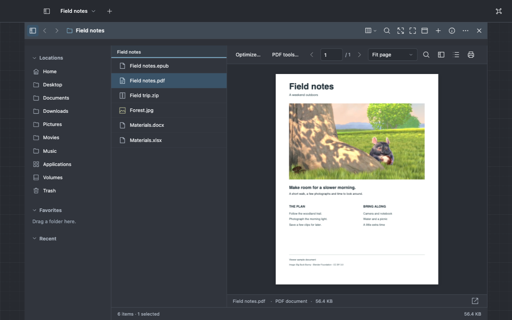
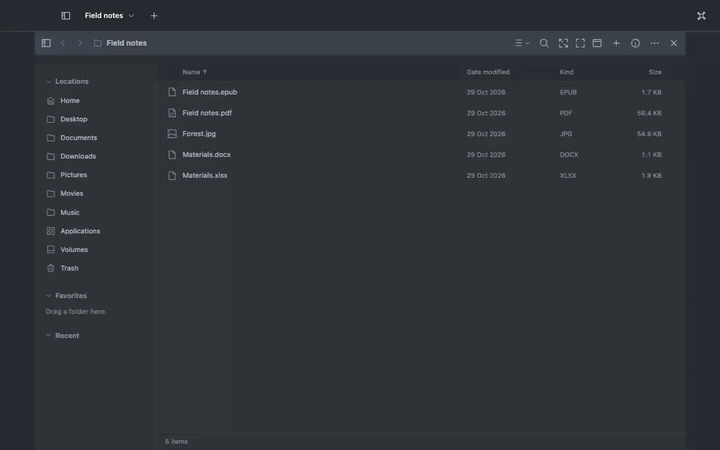
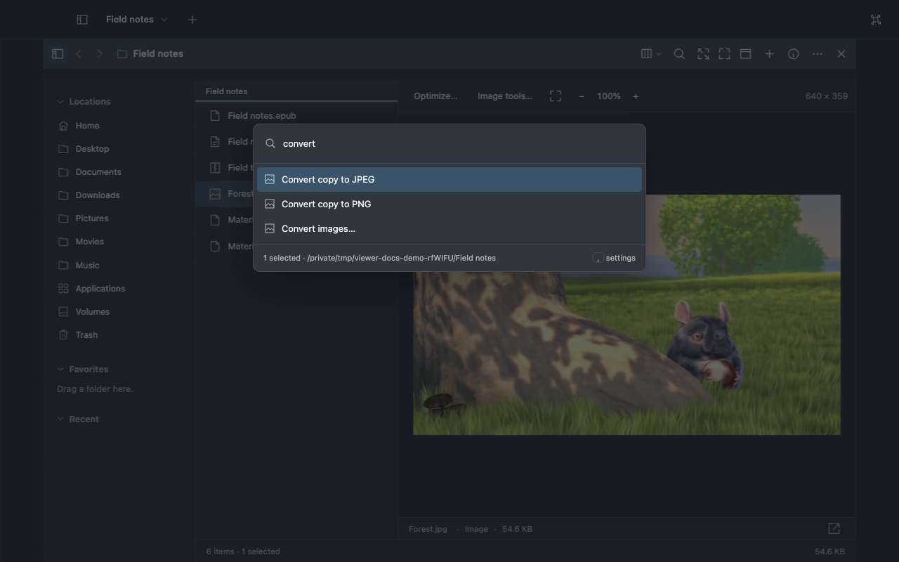
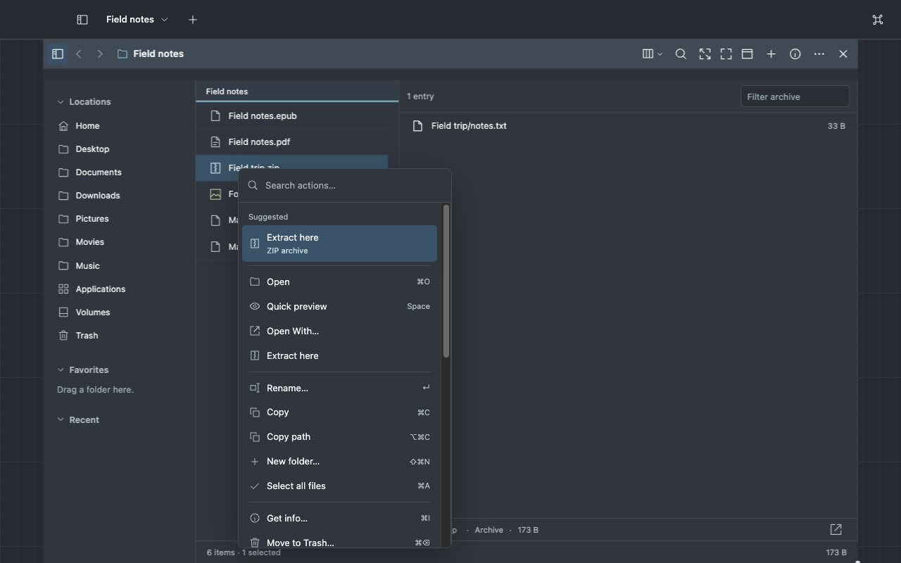
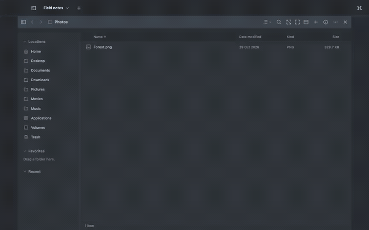
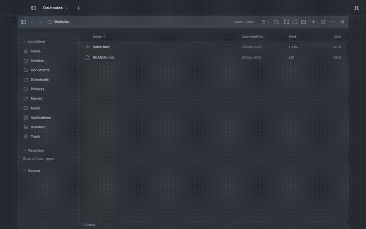

# Viewer

**A file explorer that opens everything.** Look inside more than 300 kinds of file without leaving
the folder, act on them with the right tool, and keep folders, files, terminals and browsers side by
side as planes in one 3D workspace.


**[Download for Mac](https://plurid.com/viewer)** ·
[Your first five minutes](docs/guides/getting-started.md) · [All guides](docs/guides/README.md)

For Macs with Apple silicon and macOS 14 or later. No account. Your files stay in their own folders,
and their contents leave your Mac only for a model you add and allow.

## Look inside anything

Select a file and press **Space**, or select it in Columns view. Each kind of file gets the controls
it needs.

| Files                                                      | What you can do                                            |
| ---------------------------------------------------------- | ---------------------------------------------------------- |
| PDF, EPUB, FictionBook, DjVu                               | Read pages and chapters, search the text, keep your place  |
| Word, Excel, PowerPoint, OpenDocument, Publisher           | See the real page layout, switch worksheets, step slides   |
| Photos, HEIC, PSD, SVG and 21 camera RAW formats           | Zoom, pan, render RAW, crop, resize and convert            |
| 42 video and audio formats                                 | Play them, through a local copy when Chromium cannot       |
| 3D models, STEP and IGES parts, DXF drawings               | Turn the model, measure it, choose its units               |
| Code, Markdown, JSON, YAML, CSV, SQLite, notebooks         | Read with syntax colours, trees, filtered tables and cells |
| Email, mailboxes and saved web pages                       | Read messages and pages offline, and save attachments      |
| Fonts, certificates, keys, torrents, provisioning profiles | Try a font, check a certificate chain, list a torrent      |
| ZIP and TAR archives, and the app packages built on ZIP    | Browse and preview inside without extracting               |
| Anything else                                              | Page through its bytes in a hex view, even in a 10 GB file |



[Every format and its limits](docs/reference/formats.md) ·
[Read and inspect files](docs/guides/previews.md)

<details>
<summary>Watch: find a file and look inside</summary>



[Watch or download the recording](docs/media/files.mp4).

</details>

## Work in planes

Every open view is a **plane**: a folder, a file, a note, a terminal or a browser. A file opened
from a folder stays linked to it. The planes stand in a 3D space: **rotate**, **scale** and
**translate** it from the toolbar at the bottom, dock one plane to focus, tile several, or press
**⌘0** to see them all. Each workspace keeps its own planes, and a project file brings a whole
arrangement back.


[Keep your work together](docs/guides/workspaces.md)

## Do the next thing

|  |  |
| ---------------------------------------------------------------------------------------- | ------------------------------------------------------------------------------- |
| **⌘K** finds any command by what you want to do.                                         | **Suggested** offers the next step for what you selected.                       |

Viewer suggests **Extract here** for an archive, **Optimize** for a large PDF and **Convert** for
HEIC photos, and learns what you choose. Cards above a folder point out old installers, likely
duplicates and piles of screenshots. [Explore a folder](docs/guides/explore.md)

## Make something new

The original stays as it was. Each result is a new file beside it, with Undo.

- **Convert and shrink.** Export images for the web, convert HEIC to JPEG, and shrink PDFs and
  photos with the saving measured before you keep it.
- **Edit clips and pages.** Trim and join video and audio, and rotate, reorder or combine PDF pages.
- **Lay out photos and PDFs.** Make collages, contact sheets, 2-up sheets and booklets, cards and
  passport photos, and posters across ordinary sheets. PDF pages stay sharp vectors.
- **Nest parts for cutting.** Lay out DXF parts on stock sheets for a laser or plasma cutter, with
  the sheets, cut length, time and cost it takes.

|  |  |
| ----------------------------------------------------------------------------------------------------------- | ---------------------------------------------------------------------------------------------------------------- |
| **Lay out…** picks the layout for what you selected.                                                        | **Nest for cutting…** fills holes and counts the sheets.                                                         |

[Make a quick change](docs/guides/create.md) · [Lay out photos and PDFs](docs/guides/layout.md)

<details>
<summary>Watch: convert an image and inspect the result</summary>



[Watch or download the recording](docs/media/create.mp4).

</details>

## Build software

Edit code, review Git changes hunk by hunk, and turn a branch into a task with its own worktree,
note and terminal. Serve a site from its folder and open it in a browser plane beside its request
log. [Work on a project](docs/guides/develop.md)

<details>
<summary>Watch: turn a branch into a task</summary>



[Watch or download the recording](docs/media/develop.mp4).

</details>

## Bring a model, if you want one

Viewer works fully without one. Add a local or hosted model in **Settings → Models** and choose
exactly what it may read: file names, or excerpts too. It can then explore a folder, suggest names
and actions, or identify an unknown file. Coding agents on your Mac can connect to Viewer, and each
change they propose waits for your review.

|  |  |
| ------------------------------------------------------------------------------------------- | -------------------------------------------------------------------- |
| **Explore this folder** says what it holds and links the files.                             | **File overview** finds what needs attention across your Home.       |

[Make repeated work a command](docs/guides/automate.md)

## Safe with your files

- **Nothing is deleted for good.** Removals go to the Trash, and Undo checks that a file is still
  the one it changed.
- **Originals stay.** Conversions, layouts and exports make new files.
- **Copies are instant.** On the same disk, Viewer clones a file without copying its bytes.
- **You decide what is shared.** Folder access, model data and agent actions each need your own
  approval.
- **A stuck window does not trap you.** Viewer offers to reload it, and your workspace comes back.

## The first keys

| Key         | What it does                                              |
| ----------- | --------------------------------------------------------- |
| **⌘⇧O**     | Open a folder                                             |
| **Space**   | Look inside the selected file; **Escape** closes the look |
| **⌘F**      | Find files by name; type `ext:pdf` to show only PDFs      |
| **⌘K**      | Find any command by typing what you want to do            |
| **⌘1–⌘5**   | List, Grid, Columns, Gallery or Map view                  |
| **⌘Return** | Switch between one plane and all of them                  |

[All shortcuts](docs/reference/shortcuts.md)

## Get Viewer

1. Download the Viewer disk image from the [Viewer website](https://plurid.com/viewer).
2. Open it and drag **Viewer** onto **Applications**.
3. Open Viewer from Applications. macOS asks once before opening an app from the internet; choose
   **Open**.

Viewer opens your Home folder. It checks for a newer version once a day, and **Viewer → Check for
Updates…** checks at once. [Install and update Viewer](docs/guides/install.md) covers folder access,
updates and removal. Windows and Linux are in progress; see
[platform status](docs/reference/platforms.md).

To run Viewer from source, you need macOS with the Xcode command-line tools, Node 22.22 or later,
and pnpm 11:

```sh
git clone https://github.com/plurid/viewer.git
cd viewer
pnpm install
pnpm start
```

[Build and run Viewer](docs/development/builds.md) covers local app bundles.

## Learn more

| To                                           | Read                                                      |
| -------------------------------------------- | --------------------------------------------------------- |
| Get comfortable in five minutes              | [Your first five minutes](docs/guides/getting-started.md) |
| Search, sort, rename and move files          | [Browse and organize](docs/guides/files.md)               |
| Use each file type's controls                | [Read and inspect files](docs/guides/previews.md)         |
| Convert, trim, shrink or rearrange files     | [Make a quick change](docs/guides/create.md)              |
| Make collages, booklets, posters and nests   | [Lay out photos and PDFs](docs/guides/layout.md)          |
| Keep a folder, a document and tools together | [Keep your work together](docs/guides/workspaces.md)      |
| Edit, run and review a code project          | [Work on a project](docs/guides/develop.md)               |
| Turn repeated work into a command            | [Make repeated work a command](docs/guides/automate.md)   |
| Dictate requests and notes                   | [Dictate into Viewer](docs/guides/speech.md)              |

To work on Viewer itself, start with [contributing](CONTRIBUTING.md). The
[sample playground](docs/development/playground.md) has files and projects to explore.

Part of [Plurid](https://plurid.com). Licensed under [DEL](LICENSE).
