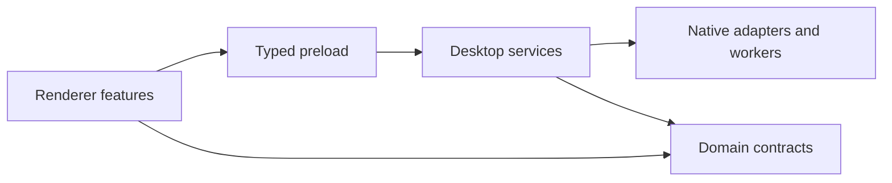

# Architecture

Paths on this page are relative to `packages/viewer-electron/app`.

## Dependency direction

Domain modules own serializable contracts, schemas and pure decisions. They have no Electron or
React dependencies. Desktop services own authority and I/O. Preload exposes a fixed typed API. The
sandboxed renderer owns presentation and user intent.

IPC validates arguments, sender/origin and the sending main frame. A renderer resource is an
owner-bound capability, not a raw filesystem or process channel.

## Feature ownership

| Feature                  | Domain                               | Desktop                                        | Renderer                                          |
| ------------------------ | ------------------------------------ | ---------------------------------------------- | ------------------------------------------------- |
| Preferences              | `domain/preferences`                 | `desktop/preferences`                          | `state`, Settings, workspace presentation         |
| Files and operations     | `domain/files`, `domain/operations`  | `desktop/files`, `desktop/operations`          | Explorer and operation review                     |
| Editing and previews     | `domain/editing`, `domain/previews`  | `desktop/editing`, `desktop/previews`, workers | Editors and preview modules                       |
| Search and comparison    | `domain/search`, `domain/comparison` | Corresponding services                         | Search and Git/comparison planes                  |
| Workspaces and tasks     | `domain/workspaces`                  | `desktop/workspaces`, windows                  | Workspace adapter and task controller             |
| Actions and workflows    | `domain/automation`                  | `desktop/actions`, `desktop/automation`        | Contextual commands and review                    |
| Agents and models        | `domain/agents`, `domain/models`     | Agent/model/chat services                      | Explicit permissions, proposals and conversations |
| Runtimes and diagnostics | Shared contracts                     | Terminals, browsers, servers, Journal          | Feature views and recovery                        |

Shared UI primitives live at the UI root; business dialogs belong to their feature. Architecture
tests enforce layer boundaries. Shared catalogs remain in domain code rather than repeated
renderer/desktop unions.

## Views and lifetimes

The workspace controller is the Plurid adapter. It owns engine IDs, placement, framing and view
restoration. Explorer session state and shared path-keyed folder presentation have different owners.
Input selection and camera input stay separate.

`workspace/content-planes.ts` owns content-view reuse and checks asynchronous results against the
captured workspace. It delegates placement to the workspace adapter. Desktop IPC groups, including
`ipc/git-handlers.ts`, keep feature dispatch together; the bridge validates sender and window role
before calling them. Git mutations still bind and validate the captured target before service entry.

Views are not resources. Notes, task references and command receipts can outlive their views.
Terminals and window-owned servers have different close behavior. Preview leases, decoders, browser
guests and cancellation release their own work. Restoring a task or project never authorizes replay
of commands or agent input.

## Persistence and authority

Atomic persistence and durable save barriers protect documents through save/close. Migration
versions come from `CURRENT_STATE_VERSION` and migration code; old inputs and invalid files remain
recoverable. Profiles are window-local presentation overlays; shared configuration stays canonical.

File access, provider data permission and local agent grants remain separate. Captured targets and
source identities are rechecked after asynchronous work or review. Editable configuration is not
effective authority. The desktop removal boundary enforces agent approval and OS Trash; see
[AGENTS.md](../../AGENTS.md).

## Performance boundaries

Large parsing, image/media rendering, indexing and folder-size scans use bounded workers/utility
processes. Decoded allocations, queues, caches and output sizes have explicit limits. Last-consumer
cancellation terminates owned work.

Model controls must disconnect before their DOM root detaches; renderer-owned GPU resources cannot
be retained through module-global texture listeners. Tests and heap snapshots cover these known
lifecycle regressions. Hidden-window frame intervals do not establish physical compositor/GPU
performance.

Read the [domain map](../../CONTEXT.md), [ADRs](../adr/README.md),
[preview extension guide](previews.md) and [testing guide](testing.md) for the next level of detail.
