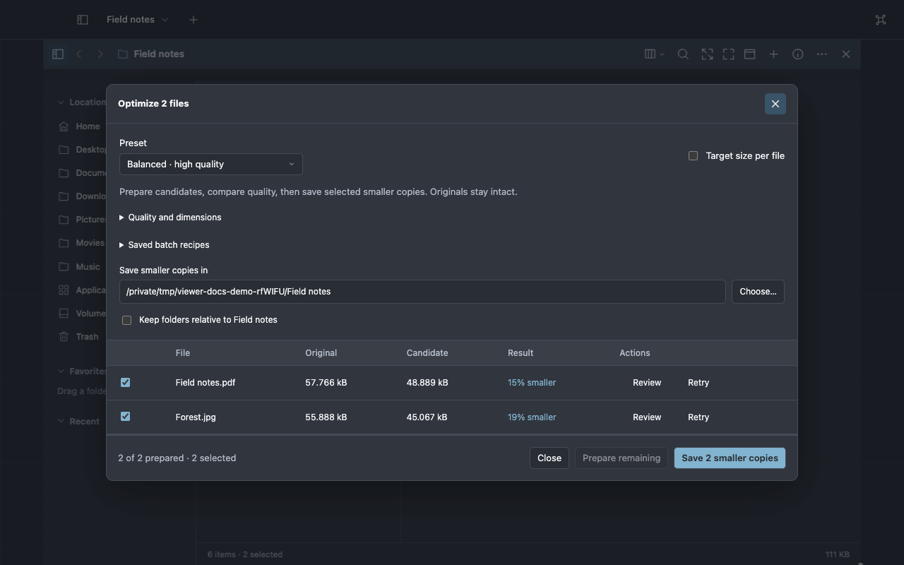

# Make a quick change

Use this guide to convert, crop or shrink images, make smaller PDFs, trim and join clips, rearrange
PDF pages and jot things down. Every tool writes new files and leaves the originals as they were, so
you can compare before and after.

**Find it:** select a file, press **⌘K** and type what you want: _convert_, _optimize_, _trim_,
_PDF_ · the same tools are in the file menu, and the preview of an image, PDF or clip has a button
for its tools

## Convert, crop or resize images

1. Select one or more images, press **⌘K** and choose **Image tools…**, also available in an image's
   preview toolbar.
2. Pick the **Format** (WebP, AVIF, JPEG or PNG) and the **Quality**.
3. Set **Width** and **Height** to resize. Under **Resize**, **Fit · keep aspect ratio** keeps the
   proportions; **Fill and crop** and **Stretch to size** fill the exact size.
4. Choose **Crop** and drag on the picture to crop it; **Reset crop** removes the crop. **Rotate**
   turns the picture a quarter turn.
5. Under **Metadata**, choose **Keep color and credit · remove GPS**, **Remove metadata** or **Keep
   all · includes location**.
6. Check the **Filename** and **Save in** folder, then choose **Export image**, or **Export 3
   images** for a selection.

For a quick web copy, choose **Images for web…** instead: WebP, quality 80, at most 2048 pixels, GPS
removed. **Batch convert images…** applies one setting to a whole selection, and **Convert copy to
JPEG** makes a JPEG copy of a HEIC photo.

## Make files smaller

1. Select PDFs or images and choose **Optimize…**.
2. Pick **Balanced · high quality**, **Smaller · stronger compression** or **Lossless · keep image
   pixels**, then choose **Prepare candidates**.
3. Read the results: each file shows its original size, its new size and the saving.
4. Untick any file you want to leave alone and check the folder under **Save smaller copies in**.
   Then choose **Save 2 smaller copies**; the button counts the files you kept.

A file marked **Already compact · original kept** could not get smaller, so Viewer keeps the
original. **PDF for email…** makes smaller copies of scanned PDFs for attaching to a message.

## Trim or join audio and video

1. Select a clip, or several, and choose **Edit media…**. The clip opens in a media plane.
2. Play the clip. Choose **Set in** and **Set out** where the part you want starts and ends, or type
   the times beside **In** and **Out**.
3. Choose **Add segment** to add that part to the **Sequence**. Repeat for every part, and put them
   in order with each segment's up and down buttons. **Add media…** brings in another clip;
   **Source** switches between clips. **Play sequence** plays the result.
4. To add music or a voice-over, choose **Add audio…** and pick the file. Under **Audio**, choose
   **Replace audio** or **Mix with original**, then set the **Audio offset (seconds)** and the gain.
5. Check the **Filename** and **Save in** folder, then choose **Export sequence** for one file. Turn
   on **Export each segment** to get **Export segments**, one file per segment, or **Export current
   frame as PNG** to get **Export frame**.

Under **Cut**, **Exact · frame accurate** is the default. For a single H.264 segment in MP4 or MOV,
**Fast · keyframe aligned** cuts at the nearest keyframe, which is quicker but less precise.

## Rearrange a PDF

1. Select one or more PDFs and choose **PDF tools…**. In a PDF's preview, **PDF tools…** opens it
   too, and **Add PDFs…** brings in more.
2. Under **Output order**, select a page and choose **Move page up**, **Move page down** or **Rotate
   page clockwise**.
3. Untick the pages you do not need, or type **Pages to include**, such as `1-3, 8`, and choose
   **Apply range**. **Include all** brings every page back.
4. Check the name and folder, then choose **Save PDF**. To get one PDF per page instead, turn on
   **Save each included page separately** and choose **Split pages**.

**Create PDF from images** turns a selection of images into one PDF.
[PDF tools](../reference/pdf.md) lists what protected and signed PDFs allow.

## Put several photos or pages on one sheet

Select photos or a PDF, press **⌘K** and choose **Lay out…** for a collage, a contact sheet, several
pages to a sheet, a booklet, cards or a poster. Select DXF drawings and choose **Nest for cutting…**
to lay out parts on stock sheets. [Lay out photos and PDFs](layout.md) has the steps.

## Write something down

| To                                 | Choose in **⌘K**               |
| ---------------------------------- | ------------------------------ |
| Keep notes that save as you type   | **New note plane**             |
| Keep a checklist                   | **New checklist plane**        |
| Write text you will save as a file | **New scratch plane** (**⌘T**) |
| Find a note or checklist again     | **Notes…**                     |

Closing a note's plane keeps the note. To remove it, choose **Move to Trash…** in the note itself.

[Media reference](../reference/media.md) has the formats and limits for every export.
