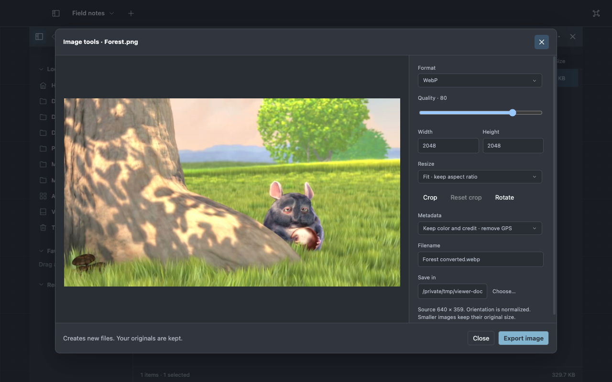

# Make a quick change

Open a file, then use its preview controls or **⌘K** to find the matching tool. Exports create new
files so you can compare the result with the original.

## Convert, crop or resize an image

1. Select an image and choose **Image tools…** or **Convert images…**.
2. Choose JPEG, PNG, WebP or AVIF. Set quality and dimensions as needed.
3. Drag a crop or enter its coordinates. Choose a destination and output name.
4. Export, inspect the result and open the output from the completed operation.

Select several images to apply the same settings as a batch. Animated and multipage inputs have
separate limits; see [media reference](../reference/media.md).

## Make files smaller

Select PDFs or supported raster images and choose **Optimize…**. Compare **Balanced**, **Smaller**
and **Lossless** according to your goal.

The result shows original size, output size and savings. A candidate is published only when it is
smaller; **Already compact** means the tool kept the original. Some PDFs and already compressed
images cannot shrink usefully.

## Trim or combine audio and video

Choose **Edit media…** for an audio/video file or a selection of clips. Set In and Out points,
reorder segments and play the draft before exporting. You can export the sequence, individual
segments, audio only, muted video or a video frame.

**Add audio** adds one replacement or mixed track with its own timing and gains. Exact cuts are the
default; the fast keyframe-aligned choice trades precision for speed. This is a focused clip editor
rather than a multitrack production timeline.

## Work on a PDF

Use **PDF tools…** to select and rearrange pages, rotate, split or merge PDFs. Review the page plan,
choose the destination and export. Scanned-PDF compression is a separate image-based choice with its
own quality tradeoffs.

See [PDF tools](../reference/pdf.md) for supported transformations and protected document limits.

## Write something down

Commands offers **New note**, **New checklist** and **New scratch plane**. Notes and checklists save
privately as you work and reopen through Notes. Scratch text becomes an ordinary file with Save As.
Closing a note's plane keeps its document; use its Move to Trash action when you want to remove the
document itself.

For a longer project, [keep the files and tools together](workspaces.md).
