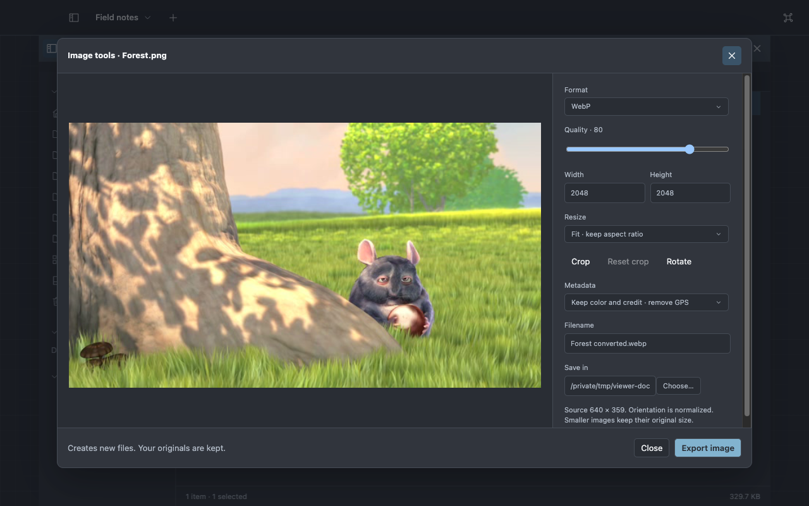
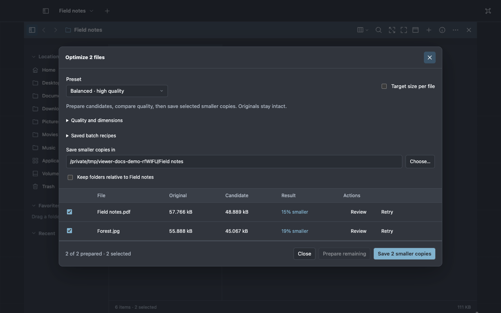

# Make a quick change

Use this guide to convert, crop or shrink images, make smaller PDFs, trim and join clips, rearrange
PDF pages and jot things down. Every tool writes new files and leaves the originals as they were, so
you can compare before and after.

**Find it:** select a file, press **⌘K** and type what you want: _convert_, _optimize_, _trim_,
_PDF_ · the same tools are in the file menu, and the preview of an image, PDF or clip has a button
for its tools

## Convert, crop or resize images

1. Select one or more images, press **⌘K** and choose **Image Tools…**, also available in an image's
   preview toolbar.
2. Pick the **Format** (WebP, AVIF, JPEG or PNG) and the **Quality**.
3. Set **Width** and **Height** to resize. The line under them shows the size and format the export
   makes. Under **Resize**, **Fit · keep aspect ratio** keeps the proportions; **Fill and crop** and
   **Stretch to size** fill the exact size. A picture smaller than that size is not enlarged; the
   line then reads **Already smaller than the target** with the size it keeps.
4. Choose **Rotate** to turn the picture a quarter turn. Then choose **Crop** and drag on the
   picture to crop it; **Reset Crop** removes the crop. Rotating after cropping removes the crop
   too.
5. Under **Metadata**, choose **Keep color and credit · remove GPS**, **Remove metadata** or **Keep
   all · includes location**.
6. Check the **File name** and **Save in** folder, then choose **Export Image**. A selection has no
   **File name**: each copy is named after its image, such as `Photo converted.webp`, and the button
   reads **Export 3 Images**. If the folder already holds that name, the export adds “copy” to the
   new file's name.

For a quick web copy, choose **Images for web…** instead: WebP, quality 80, at most 2048 pixels, GPS
removed. **Batch convert images…** applies one setting to a whole selection, and **Convert Copy to
JPEG** makes a JPEG copy of a HEIC photo.

## Make files smaller

1. Select PDFs or images and choose **Optimize…**.
2. Pick **Balanced · high quality**, **Smaller · stronger compression** or **Lossless · keep image
   pixels**, then choose **Prepare candidates**.
3. Read the results: each file shows its original size, its new size and the saving. **Review** on a
   row shows the original and the copy side by side.
4. Untick any file you want to leave alone and check the folder under **Save smaller copies in**.
   Then choose **Save 2 smaller copies**; the button counts the files you kept.

A file marked **Already compact · original kept** could not get smaller, so Viewer keeps the
original. **PDF for email…** makes smaller copies of scanned PDFs for attaching to a message.

## Trim or join audio and video

1. Select a clip, or several, and choose **Edit Media…**. The clip opens in a media plane, and the
   **Sequence** there starts with each selected clip whole, as one segment.
2. Play the clip. Choose **Set In** (**I**) and **Set Out** (**O**) where the part you want starts
   and ends, or type the times beside **In** and **Out**. This trims the segment selected in the
   **Sequence**. To keep one part of one clip, that is all: go to step 5.
3. For another part, choose **Add Segment**: it adds the same range as a new segment, which you then
   mark with **Set In** and **Set Out**. Put the segments in order with each segment's up and down
   buttons. **Add Media…** brings in another clip; **Source** switches between clips. **Play
   Sequence** plays the result. A clip brought in with **Add Media…** joins the **Sequence** once
   you choose it under **Source**, mark its part and choose **Add Segment**.
4. To add music or a voice-over, choose **Add Audio…** and pick the file. Under **Audio**, choose
   **Replace audio** or **Mix with original**, then set the **Audio offset (seconds)** and the gain.
5. Check the **File name** and **Save in** folder, then choose **Export Sequence** for one file.
   Turn on **Export each segment** to get **Export Segments**, one file per segment, or **Export
   current frame as PNG** to get **Export Frame**.

Under **Cut**, **Exact** is the default. For a single H.264 segment in MP4 or MOV, **Fast** cuts at
the keyframe before the start, which is quicker; the clip can start a few seconds early.

## Rearrange a PDF

1. Select one or more PDFs and choose **PDF Tools…**. In a PDF's preview, **PDF Tools…** opens it
   too, and **Add PDFs…** brings in more.
2. Under **Output order**, select a page and choose **Move page up**, **Move page down** or **Rotate
   page clockwise**.
3. Untick the pages you do not need, or type **Pages to include**, such as `1-3, 8`, for the PDF
   chosen under **Source PDF**, and choose **Apply Range**. **Include All** brings every page back.
4. Check the name and folder, then choose **Save PDF**. To get one PDF per page instead, turn on
   **Save each included page separately** and choose **Split Pages**.

**Create PDF from Images** turns a selection of images into one PDF.
[PDF tools](../reference/pdf.md) lists what protected and signed PDFs allow.

## Put several photos or pages on one sheet

Select photos or a PDF, press **⌘K** and choose **Lay Out…** for a collage, a contact sheet, several
pages to a sheet, a booklet, cards or a poster. Select DXF drawings and choose **Nest for Cutting…**
to lay out parts on stock sheets. [Lay out photos and PDFs](layout.md) has the steps.

## Write something down

| To                                 | Choose in **⌘K**               |
| ---------------------------------- | ------------------------------ |
| Keep notes that save as you type   | **New Note Plane**             |
| Keep a checklist                   | **New Checklist Plane**        |
| Write text you will save as a file | **New Scratch Plane** (**⌘T**) |
| Find a note or checklist again     | **Notes…**                     |

Closing a note's plane keeps the note. To remove it, choose **Move to Trash…** in the note itself.

[Media reference](../reference/media.md) has the formats and limits for every export.
