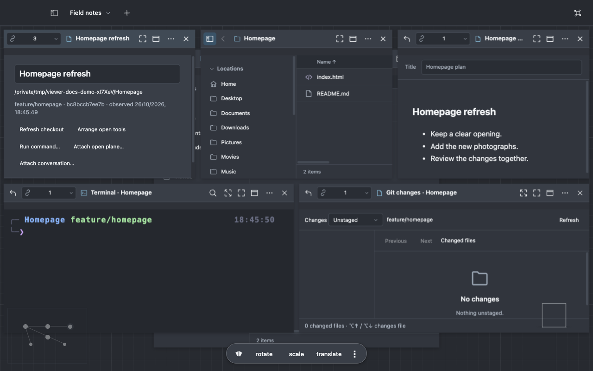

# Work on a project

Open your project folder. The same folder context follows its editor, terminal, Git changes and
local server.

## Edit and run

Open a source file as a linked plane and choose **Edit**. Use ordinary Save and Save As. Unsaved
buffers survive closing the application; external changes have conflict recovery rather than
silently replacing your draft.

Choose **Run command…** to run a shell line in the captured folder with output and Stop controls.
Choose **Open terminal plane** for an interactive shell. External terminal and tmux actions are
available when those programs are installed.

## Review a branch

Enable Git status if you want background badges. Open **Git changes** for the current checkout,
choose a comparison base and inspect a changed file. Stage or unstage individual supported hunks.
Git actions operate on the real checkout and use its normal hooks and configuration.

To work on two branches at once, use **Open worktree…** or **Create worktree…**. Each checkout has
its own working files and staging index. Multiple views of one checkout share those files and
staging.

## Start a task from a branch

1. In the repository folder, choose **New task from branch…**.
2. Choose the base, name the branch and task, and review the worktree destination.
3. Create the task. Viewer opens its folder, notes, terminal and Git tools.
4. Reopen the area from **Tasks…** as you move between jobs.

The task retains its tool references when views close. Restoration does not rerun commands.
[Tasks and Git](../reference/tasks-and-git.md) covers review position, command receipts and checkout
identity.

## Look at a local site

Use the local-server command for a static folder, then open its address in a browser plane. You get
basic navigation and the server's request log beside the source. **Local servers…** reopens controls
after their plane closes.

The built-in static server does not build frameworks or provide their hot reload. Run the project's
own development command when needed, then open that address in a browser plane.
[Browser reference](../reference/web.md) explains the distinction between a browser plane and a
sandboxed HTML file preview.

## Attach a conversation

Attach a Viewer conversation or an explicit external-agent session report to a task. File and diff
references open as linked views. External statuses are labeled **Reported**, with their timestamp;
Viewer does not infer progress from terminal text. [Agent integration](../reference/agents.md)
explains the adapter boundary.

For repeatable test/build sequences, continue with [custom commands](automate.md).
