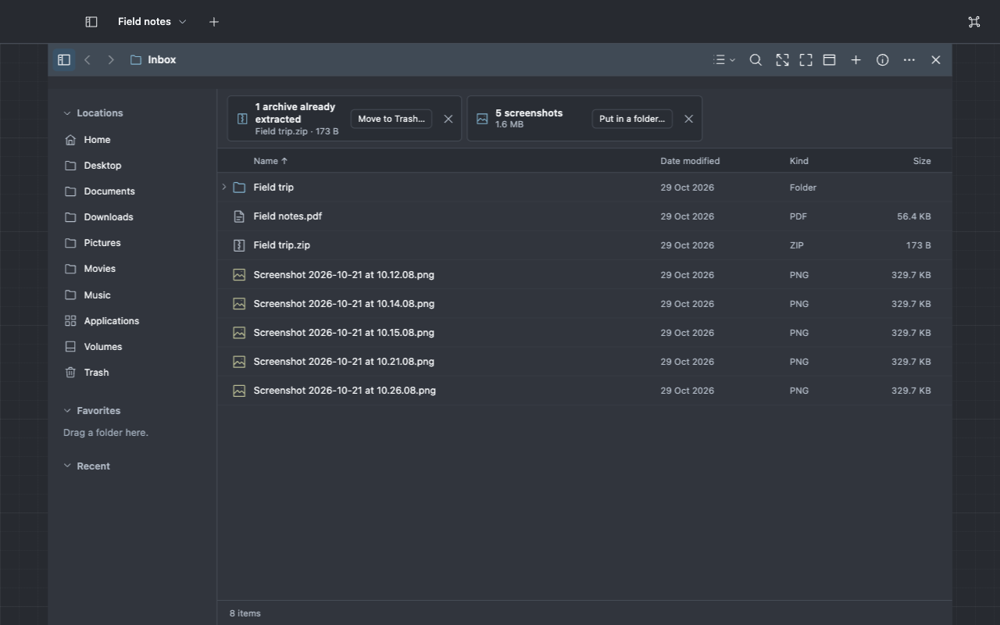
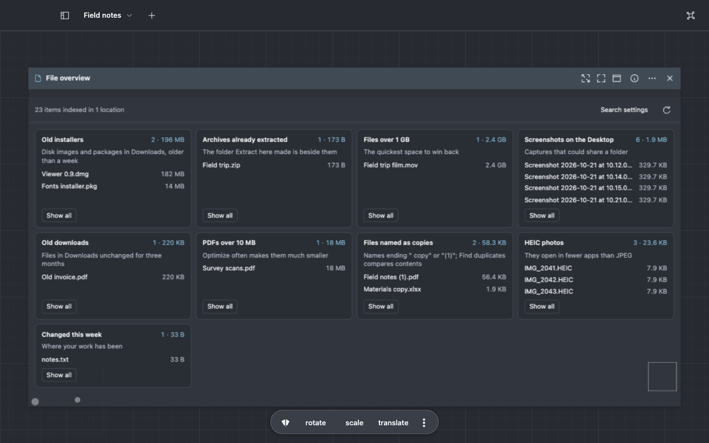
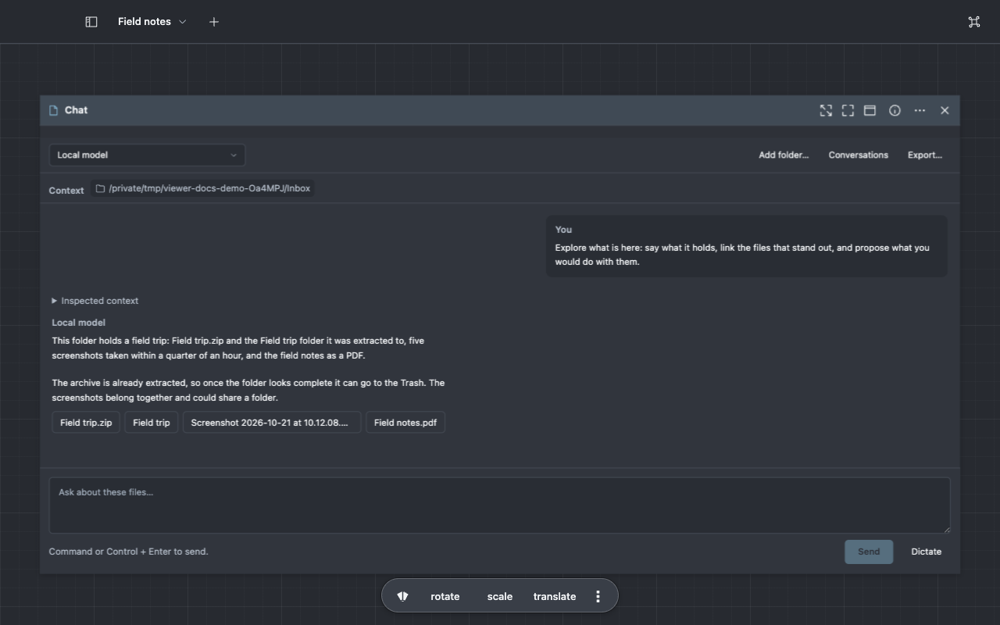

# Explore a folder

Viewer points out what may need attention, suggests what to do next and, when you add a model, looks
around a folder with you. Nothing changes until you choose an action or approve a review.

## See what needs attention

Open a folder. When something stands out, a card above the files says what and offers one action:

| Viewer notices                                 | Action offered             |
| ---------------------------------------------- | -------------------------- |
| Archives already extracted beside their folder | **Move to Trash…**         |
| Installers in Downloads older than a week      | **Move to Trash…**         |
| Five or more screenshots                       | **Put in a folder…**       |
| PDFs over 10 MB                                | **Optimize…**              |
| Three or more HEIC photos                      | **Convert copies to JPEG** |
| Names ending " copy" or "(1)"                  | **Find duplicates…**       |

The action selects the files it covers first, so you see what it will act on, then opens the same
command as the file menu. **Move to Trash…** asks first, unless you turned off **Confirm before
moving to Trash**. Choose **×** on a card to hide it in that folder; **⌘K** → **Show hidden
insights** brings them back. Turn insights off in **Settings → Browsing → Suggestions**.

## See all your files at a glance

Press **⌘K** and choose **File overview**. A File overview plane searches the filename index for
what may need a look:

| Card                       | Looks for                                                          |
| -------------------------- | ------------------------------------------------------------------ |
| Old installers             | dmg and pkg files in Downloads older than a week                   |
| Archives already extracted | Zip and tar archives with the folder Extract here made beside them |
| Files over 1 GB            | The largest files in every indexed location                        |
| Screenshots on the Desktop | Names starting "Screenshot" or "Screen Recording"                  |
| Old downloads              | Files in Downloads unchanged for three months                      |
| PDFs over 10 MB            | PDFs that Optimize can often shrink                                |
| Files named as copies      | Names ending " copy" or "(1)"                                      |
| HEIC photos                | Photos that open in fewer apps than JPEG                           |
| Changed this week          | Where your work has been                                           |

Each card shows how many files match, their total size and the largest few (the latest, for Changed
this week); choose a name to open it. **Show all** opens the matches as a search, where you select
them and use any action, such as **Move to Trash** or **Optimize…**. For archives already extracted,
which no search can name, it opens a collection of exactly those archives, kept with the workspace
and updated each time. Searches with no matches are listed in one line at the bottom. **Refresh**
searches again.

File overview reads only the index. When Downloads or the Desktop is not indexed, its card offers
**Search it now**, which searches the folder directly, and **Add to the index**, which opens
**Settings → Search**.

## Let the model pick suggestions

Right-click a file to see **Suggested** actions, as [Browse and organize](files.md) shows. With a
model, Viewer can add its own picks:

1. [Add a model](automate.md#add-a-model) and mark it **Use for Ask Viewer**.
2. In **Settings → Models** → **Data access**, allow it file names.
3. Turn on **Settings → Browsing → Suggestions** → **Let the model suggest actions**.

When you stay in a folder, Viewer sends the model the folder's name, a few names of each kind of
file and the actions that apply to them, once per folder. Its picks appear under **Suggested** with
its reason and its name, for example "Smaller to send · My model". It never receives file contents
and never picks Trash.

## Ask the model what is here

1. Press **⌘K** and choose **Explore this folder**, or right-click empty space in the folder and
   choose **Files** → **Explore this folder**. With files selected it reads **Explore selected
   items**; for a folder it also appears under **Suggested**.
2. A Chat plane opens with the folder attached. When the model may already receive names, the
   request goes at once; otherwise choose **Allow names**, then **Send**.
3. The model lists the folder, looks closer at a few files and answers with a summary. Files it
   mentions appear as buttons under the answer; choose one to open it beside the chat.
4. A proposed action shows **Review proposal**. Nothing runs until you approve it.

To read inside files the model asks for excerpts first. Ask follow-up questions in the same chat.

## Identify a file Viewer cannot show

When no preview reads a file, Viewer reads its first bytes and says what it looks like, for example
**Looks like a SQLite database**.

1. When Viewer reads that kind of file, choose **Show as SQLite database** to see it in place.
   Books, Office and OpenDocument files, camera raw photos and videos open this way too. Otherwise
   the message names the extension that makes it preview.
2. To ask the model, choose **Ask** followed by its name. It receives the file's name, size and
   first 64 bytes, so it needs the excerpts permission; **Review in Settings** opens **Settings →
   Models** when it does not have it.
3. The model's answer appears under the buttons with its name: what the file is, its usual extension
   and apps that open it. When Viewer reads what it names, **Show as** appears for it too.

[Formats](../reference/formats.md#files-whose-name-does-not-say) lists what shows this way.

## What a model receives

| Feature               | The model receives                                    | Permission           |
| --------------------- | ----------------------------------------------------- | -------------------- |
| Model suggestions     | The folder's name, file names, kinds and action names | Names                |
| Explore               | Names in the attached folder; excerpts when it reads  | Names, then excerpts |
| Identify with a model | One file's name, size and first 64 bytes              | Excerpts             |

Folder insights, Suggested rules and identifying by bytes run on your computer and send nothing.
