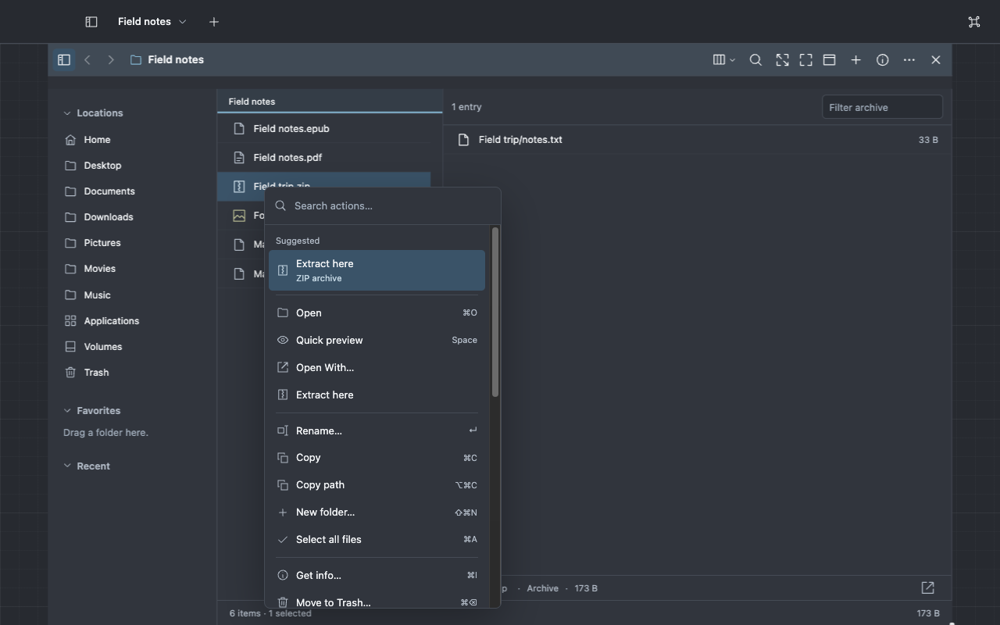

# Browse and organize

Use this guide for everyday file work in a
[files plane](../reference/terms.md#planes-and-the-space): picking a view, selecting, copying,
renaming, finding files, measuring folders and getting things back from the Trash.

**Find it:** right-click a file or empty space for the file menu · **⌘F** to find files · **⌘K** for
any command by name · **File** and **Edit** in the menu bar

Each folder remembers its own view, sort order and column widths. A second plane on the same folder
keeps its own selection.

## Go to a folder

1. Press **⌘L** or **⇧⌘G** for **Go to Folder…**. The current path starts selected, ready to copy
   with **⌘C** or extend with **End**. Untouched or empty, the field suggests folders you visit
   often and have used recently.
2. Type part of a folder's name or path to narrow the suggestions. Near-miss spellings match too.
   Matches in the folder's own name come first; frequency and recency break equal matches.
3. Use **↑** and **↓** to choose, then **Return** to open that suggestion. You can also click it.
   For a name fragment, the first suggestion is active and **Return** opens it. If you press
   **Return** before suggestions arrive, Viewer waits and opens the top result when checking ends.
   Without an arrowed choice, a typed path opens; a mistyped path shows an error and stays in the
   field. Paths start with `/`, `~`, `./` or `../`. Names such as `.config` and fragments such as
   `proj/2026` search history. `~` and `~/Documents` start at Home.

You can also type a fragment in **⌘K**. Matching **Frequent folders** arrive below the existing
results. Favorites, recent folders and open planes keep their place. Type `z` and a fragment for up
to ten matches with literal words in order, ending in the folder's name. Already checked folders
appear immediately, including folders checked in the background after launch. Other matches wait
briefly for higher-ranked checks. Later palette results appear below rows already shown. Known
unavailable folders stay hidden until they are available again; disconnecting a disk does not forget
its folders. In the App Store edition, remembered folders whose permission is not in use are listed
unchecked and checked when you open them. The sidebar's **Recent** list keeps its newest-first
order.

Choose **Clear Recent Folders** in **⌘K** or **Go to Folder…**, or **Clear** beside the sidebar's
**Recent** heading, to clear both the Recent list and visit counts across windows. **Undo clear
recent folders** restores them from the offer in the clearing window. The offer lasts eight seconds;
dismissing it, quitting or clearing again in another window ends it. Renamed folders return under
their new paths. This history stays on this Mac and is included with recents in a personal backup.
Trash and archive contents are never learned. See the
[navigation limits](../reference/capabilities.md#open-and-move-around).

Clearing also forgets found workspace entries and probes, except workspaces linked open or holding
remembered planes, regardless of their age, and brings back the workspace cards you hid for found
workspaces; cards hidden for definitions you wrote stay hidden. Undo restores visits for the
background finder and hides those cards again. Unchanged folder paths and explicit definitions give
the same keys when those folders are found again. This found metadata is private and excluded from
backups.

Clearing also forgets declared commands' **Last run** references. Undo does not restore these
references. See [Declared commands](../reference/terminals.md#declared-commands).

## Open and save in Viewer

File, folder and save dialogs open inside the Viewer window that requested them. Settings uses its
own window. Locations, Favorites and recent folders appear on the left.

1. Choose a location, double-click a folder, or enter a **Folder path** and press **Enter**. **⌘⇧G**
   (**Ctrl+Shift+G** on Windows/Linux) focuses the path. `~` opens Home.
2. Type in **Filter by name…** to narrow the current folder. Press **↓** to move into the list.
   **Show Hidden Files** includes names starting with a dot and, on macOS with a helper built from
   the current source, items with the hidden flag. **File type** limits eligible files.
3. Select a file and choose **Open**. When multiple selection is available, use **Shift** for a
   range or **⌘** (**Ctrl**) to add an item. **⌘A** (**Ctrl+A**) selects eligible files only.
4. When saving, enter **File name** and press **Enter** or choose **Save**. **New Folder** creates a
   destination without leaving the dialog. Exports that require a new file refuse existing names;
   editor **Save As** asks before replacing a file and preserves its previous version.

**Escape** or **Cancel** leaves the selection unchanged. **System dialog…** opens the operating
system picker when needed. macOS sandbox access grants and protected agent approvals continue to use
system dialogs. Editor save warnings and ordinary app notices use Viewer's dialog style.

## Pick a view

| View        | Key    | Best for                                             |
| ----------- | ------ | ---------------------------------------------------- |
| **List**    | **⌘1** | Sorting by name, date, kind or size                  |
| **Grid**    | **⌘2** | Thumbnails                                           |
| **Columns** | **⌘3** | Following a folder trail, with a preview beside it   |
| **Gallery** | **⌘4** | One large file at a time while you move through them |
| **Map**     | **⌘5** | Arranging items in space without moving the files    |

The **View mode** button in the folder's header switches views too. To group items, right-click
empty space and choose **View → Group by**, then **Group by Kind** or **Group by Date Modified**.
**⌘⇧.** shows or hides hidden files. Links have kind **Alias**, including links to folders, and
**Group by Kind** places them in **Aliases** before **Folders**. They still open their targets;
ordinary name, date and size sorting keep their existing order.

On macOS, a helper built from the current source also hides items carrying the hidden flag, such as
files a Windows PC marked hidden on an SMB share. This includes system folders hidden in Finder:
`~/Library`, `/bin`, `/sbin`, `/usr`, `/tmp`, `/var` and `/Volumes`. They still complete when you
type a path. Viewer uses the flag and dot-prefixed names, never a filename pattern. An older or
missing helper, or an unreadable flag, falls back to the dot-name rule without blocking the listing.

**Columns** shows the path from the filesystem root to the current folder and scrolls that folder
into view. Scroll left to reach its ancestors, or use the left and right arrow keys to follow the
folder trail.

Drag a column's right divider to resize it. The preview fills the space after the list columns and
has its own right divider. The plane keeps its width in every folder it shows, and two planes keep
their own. A narrow plane scrolls horizontally while the preview keeps at least 320 px.

Sizes use decimal units, as Finder shows them: 1 KB is 1,000 bytes and 1 MB is 1,000,000 bytes.

## Arrange the sidebar

Drag a location or favorite to reorder it. A line above or below a row marks where it will be
inserted. Dragging to Favorites adds a shortcut. These gestures change the sidebar only.

On macOS, the default Locations order is **Desktop**, **Documents**, **Downloads**, **Pictures**,
**Movies**, **Music**, **Applications**, **Home**, **Volumes**, **Trash**. Windows and Linux use
**Videos**, their applications location and **Computer**. Saved custom order takes precedence; Trash
stays at the end.

## Select

- Click to select. **Shift**-click selects a range; **⌘**-click adds or removes one item.
- **⌘A** selects everything. Click empty space, or press **Escape**, to clear the selection.
- Type the first letters of a name to jump to it.
- **⌃⌘=** (**Select by Pattern…**) selects names such as `*.jpg`; **⌃⌘-** (**Deselect by Pattern…**)
  deselects them.

## Copy, move and rename

| To                       | Do                                                                        |
| ------------------------ | ------------------------------------------------------------------------- |
| Copy and paste           | **⌘C**, then **⌘V** in the destination                                    |
| Move                     | **⌘C**, then **⌥⌘V** (**Move Copied Items Here**) in the destination      |
| Move by dragging         | Drag onto a folder: it moves on the same disk and copies to another       |
| Choose copy or move      | Hold **Option** while you drop to copy, **⌘** to move                     |
| Rename                   | Select, press **Return**, type, press **Return**                          |
| Duplicate                | **⌘D**                                                                    |
| Make a folder            | **⌘N**; **⌃⌘N** (**New Folder with Selection…**) puts the selection in it |
| Copy a file's full path  | **⌥⌘C** (**Copy Path**)                                                   |
| Copy a path in a dialog  | Click the path to select all of it, or click the copy button beside it    |
| See size, dates and tags | **⌘I** (**Get Info…**)                                                    |

With a picture and no copied files on the clipboard, **Paste Here** (**⌘V**) saves and selects
`Pasted image.png`, using a unique name when needed. **Undo File Operation** moves it to the Trash.

A copy on the same disk is instant: on APFS, Viewer clones the file, so the copy shares the
original's storage until either one changes. Copies to another disk read and write every byte.

When a name already exists at the destination, Viewer asks whether to **Skip**, **Keep both** or
**Replace**. The **File operations** button in the title bar shows each operation as a
[job](../reference/terms.md#changes-and-recovery), with its progress and failures. Choose **Clear
all** in that panel to dismiss finished operations, including failures. Running and queued
operations stay visible. Undo and recovery receipts remain available.

**⌘Z** undoes the last file operation, and **⇧⌘Z** redoes it. An operation offers **Undo** for the
items it finished, even when another item failed. Undo first checks that the files are still as the
operation left them.

## Let Viewer suggest

Right-click a shortcut in **Favorites** for **Suggested → Remove from Favorites**. This removes the
saved shortcut; the folder and its contents stay in place.

Right-click a file. Under **Suggested**, Viewer offers up to three actions that fit it, each with
its reason:

| Selection                             | Suggested                                                               |
| ------------------------------------- | ----------------------------------------------------------------------- |
| A zip or tar archive                  | **Extract Here**                                                        |
| A PDF over 10 MB                      | **Optimize…**                                                           |
| A JPEG or PNG photo over 3 MB         | **Images for web…**                                                     |
| A HEIC photo                          | **Convert Copy to JPEG**                                                |
| Several photos                        | **Lay Out…**, **Create PDF from Images**                                |
| Three or more photos                  | **Batch rename…**                                                       |
| DXF drawings                          | **Nest for Cutting…**                                                   |
| A video or audio file                 | **Edit Media…**; **Extract audio…** for a video                         |
| An Office or OpenDocument file        | **Save PDF Copy**                                                       |
| A text or code file                   | **Edit Text**                                                           |
| A folder                              | **Calculate Size**; **Git Changes** in a repository, with Git status on |
| Several items                         | **Compress to ZIP**                                                     |
| A name ending in " copy" or "(2)"     | **Find Duplicates…**                                                    |
| An installer in Downloads, a week old | **Move to Trash…**                                                      |

What you choose for a kind of file rises for that kind next time: if you always rename PDFs, PDFs
suggest it. The same suggestions appear in **⌘K** before you type, and the best one appears as a
button in Quick Preview. Turn them off with **Settings → Browsing → Suggestions → Suggest actions in
file menus**; **⌘K** → **Forget Learned Suggestions** clears what Viewer learned. A folder can also
point out what needs attention, and a model can add its own picks: see
[Explore a folder](explore.md).

**Extract Here** puts an archive's contents in a folder named after it, beside the archive. When the
archive holds one folder with everything inside, that folder's contents are the result, so you never
get a folder inside a folder of the same name.

## Rename many files at once

1. Select the files, press **⌘K** and choose **Batch rename…**.
2. Say what changes: a **Filename template** such as `Trip {number}{extension}`, a **Prefix** or
   **Suffix**, or **Find text** and **Replace with**. Choose **Prepare Changes**.
3. Review the old and new names. Untick any file that should keep its name, then choose **Apply 12
   changes**; the button counts the files that change.

**Rename as book…** names PDFs and EPUBs from their own publication details: year, authors, title
and publisher.

## Find files

1. Press **⌘F** and type part of a name. Matches appear as you type; choose one to open it.
2. To search below the folder, choose **This Folder** beside the results and change it to
   **Subfolders**. **Indexed Locations** searches every location Viewer has indexed.
3. Add filters: `ext:pdf`, `kind:folder`, `size>10mb`, `modified<7d`. Combine them with spaces.
4. For words inside documents, turn on **Document text**. First turn on **Contents** for the
   location in **Settings → Search**; **Add Location…** adds another.
5. **Open Results** keeps the matches in a search plane. **Save Search…** keeps the query.

To filter the folder you are in as you type, choose **Search this folder** (the magnifier) in the
plane's header. **Subfolders** includes names in nested folders. For document text, use the search
panel's **Document text** option.

A content result opens its passage in the document. [Search](../reference/search.md) lists every
filter and how to save a search.

## See what takes space

- Choose **Calculate Size** on a folder to measure it. Folders are not measured until you ask, so a
  large disk stays fast to browse.
- **Find Duplicates…** lists identical files in the selected folders.
- **Compare Locations…** shows what differs between two folders.

## Trash and restore

**⌘⌫** (**Move to Trash…**) moves the selection to the operating system's Trash. Viewer never
deletes a file for good. Closing a plane only closes its view; it never deletes files.

To get a file back, choose **Trash** in the sidebar, select the item and choose **Put Back**. Choose
**Put Back To…** when Viewer does not know where the file came from, which is the case for files
trashed by other apps. Browsing the Trash needs Full Disk Access for Viewer in **System Settings →
Privacy & Security**.

## Share a folder with a Windows PC

1. Select one folder. Right-click and choose **Share on the Network…**, or find it with **⌘K**. An
   already shared folder offers **Network Sharing…**.
2. Copy the folder path if needed. Choose **Open File Sharing Settings**. In System Settings, open
   **General → Sharing**, turn **File Sharing** on, and open its information button.
3. Under **Shared Folders**, click **+** and choose the folder. Choose the users and their read or
   write permissions. On macOS 13 to 15, in File Sharing's details, Control-click the folder under
   **Shared Folders**, choose **Advanced Options**, and clear **Allow guest users** unless you mean
   to share with everyone on the network. The location may differ on other macOS versions.
4. Return to Viewer. The window refreshes and shows whether the folder is shared. Choose **Copy**
   beside a Windows address, then paste it into File Explorer's address bar on the PC. Keep spaces
   in a Windows address as shown. On another Mac, use Finder's **Go → Connect to Server…** with the
   Mac address. Wi-Fi and Ethernet addresses are labeled; VPN and virtual interfaces are omitted.
   With IPv6 only, use the local host name address. Both computers must be on the same local
   network. If neither Wi-Fi nor Ethernet has a local network address, Viewer says that this Mac is
   not on a network beside the addresses. VPN and virtual interfaces do not dismiss that hint.
   Windows addresses are omitted for names Windows cannot use, including names ending in a dot or
   space.

Shared folders and the folders inside them have a **Shared** mark in file views and the sidebar.
Inside a share, the details say **Inside the shared folder** and its name. **Get Info…** (**⌘I**)
shows the share name, registered or guest access, read-only status, the File Sharing service and
copyable addresses under **Network sharing**. If File Sharing is off, the share still exists but
nobody can connect. **Refresh Sharing** reads its state again. Viewer also refreshes when a folder
view opens and when you return to the app. Navigation reuses sharing state for at least five
seconds. A listed share whose folder is missing is checked again during navigation, at most once a
second, without rereading the share list. Opening **Get Info…** or **Network Sharing…** and choosing
**Refresh** checks that folder without waiting for other rows. Returning to the app also requests a
fresh read. While checking, the window says so. If Viewer cannot read the state, it says **Viewer
couldn't check whether this folder is shared.** It does not say that the folder is not shared. When
an unreadable share's real path is known, only its possible contents become unknown. If its path
cannot be resolved, sharing state is unknown for all folders because an alias could lead elsewhere.
Folders on a network volume are not shared by this Mac and do not acquire a **Shared** mark here.

The warning **Anyone on the same network can open this folder without a password.** means guest
access is on. When File Sharing is off, the warning says that nobody can connect now and describes
what guests will be able to do if it is turned on. An explicit global guest restriction, when macOS
lets Viewer read it, takes precedence over the share's guest setting.

When the share allows writes and the folder's permissions or access list grant guests a modifying
right, Viewer adds **Guests can also modify this folder or its contents.** This refers to the folder
whose details are open. If an alias resolves to a different path, the warning identifies that path.
A subfolder uses its own permissions. Access list order and deny entries apply; an entry marked only
for inheritance does not grant access to the folder itself. If an access list cannot be checked, the
warning says guests may be able to modify the folder and explains why. Unresolved group membership
keeps that cautious warning. A guest who owns the folder can change its permissions, even with no
write bit set. Older helpers still recognize world-write mode bits; other uncertain access lists say
that this build could not check them. These warnings stay visible. Choose **Network Sharing…** and
clear **Allow guest users** in **Advanced Options**, as described above, if that is not what you
intended.

To stop, choose **Network Sharing… → Open File Sharing Settings**, select the folder under **Shared
Folders**, then click the remove button. Return to Viewer to see the result. Viewer reads sharing
state and opens Settings; it never changes share points or asks for an administrator password.
**Share…** remains the macOS share sheet for AirDrop and other destinations.

Network sharing marks, details and commands are available in the direct macOS edition only. Agents,
custom actions, the terminal CLI and MCP cannot open this flow, enumerate the share points or open
Sharing settings. See [platform differences](../reference/platforms.md).

## On a network share without a Trash

Many network shares have no Trash, and Viewer never deletes a file instead.

- **Move to Trash** refuses there and leaves the item where it is. Move it to a disk with a Trash
  first, or delete it from another app.
- Saving over a file, or choosing **Replace**, keeps the previous version beside it, such as
  `Notes (previous).md`. **File operations** names the file it kept. Remove it yourself when you no
  longer need it.

[File operations](../reference/file-operations.md) covers name collisions, archives and recovery
after an interrupted copy.
