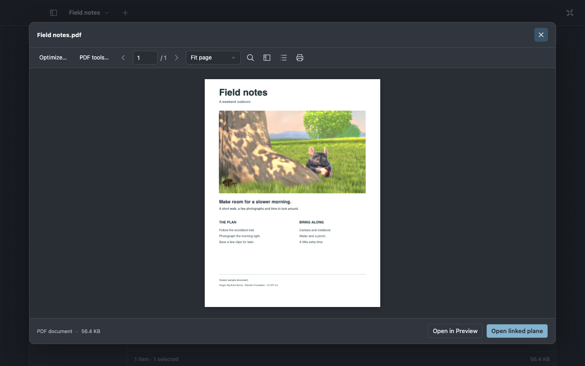

# Your first five minutes

Viewer starts as a file explorer. You can use it that way for as long as you like.

If you have not launched it yet, follow [Get Viewer running](../development/builds.md). The current
developer build is qualified on Apple Silicon macOS; see
[platform status](../reference/platforms.md) for other targets.

## Open a folder

Choose **Open folder…**, or press **⌘⇧O**, and select a folder you know. The sidebar also opens
familiar places such as Documents, Downloads and Pictures.

Use the view menu in the folder header to choose List, Grid, Columns, Gallery or Map. Double-click a
folder to enter it. Back returns to the previous location; **⌘↑** opens the parent folder.

## Look inside a file

Select a file and press **Space**. Try a photograph, PDF, Office document or video. Press **Escape**
to close the quick preview.

In Columns view, selecting a file also shows its preview beside the folder trail. Supported formats
and their limits are listed in the [preview reference](../reference/formats.md).

## Find something

Press **⌘F** and type part of a filename. Use **Subfolders** when you want to look deeper. For words
inside a document, choose **Search contents**. Content search uses the locations you enable in
**Settings → Search**.

Try `ext:pdf` to show PDFs. The [search guide](../reference/search.md) introduces other filters when
you need them.

## Keep a preview beside the folder

Choose **Open linked plane** in Quick Preview. A _plane_ is simply an open view: a folder, file or
tool that you can keep beside another view.

Use the plane's Dock control to focus on it. **⌘Return** switches between focused and spatial views.
Closing a linked child returns you to its parent.

You do not need to arrange a 3D workspace to browse files or use quick tools.
[Workspaces](workspaces.md) explains the extra room when you want it.

## Find an action

Right-click a file for its available actions, or press **⌘K** and type what you want to do: Rename,
Image tools, Optimize, New note or Open terminal plane. Commands use your current folder and
selection.

Choose **Help → What Can I Do Here?**, or the information button in a plane header, to explore
actions and their shortcuts. Search with ordinary words; approximate spellings suggest actions for
you to choose. Pin useful actions to that kind of plane without changing how they run.

Keep going with [everyday file work](files.md), [quick creative tools](create.md), or
[a project workspace](develop.md).
