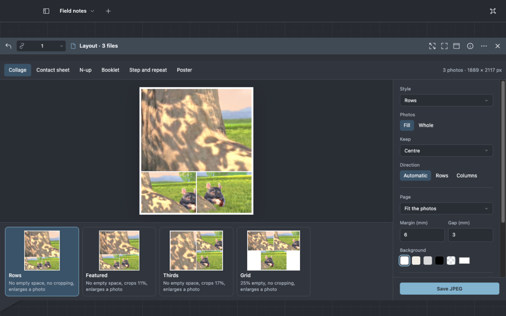
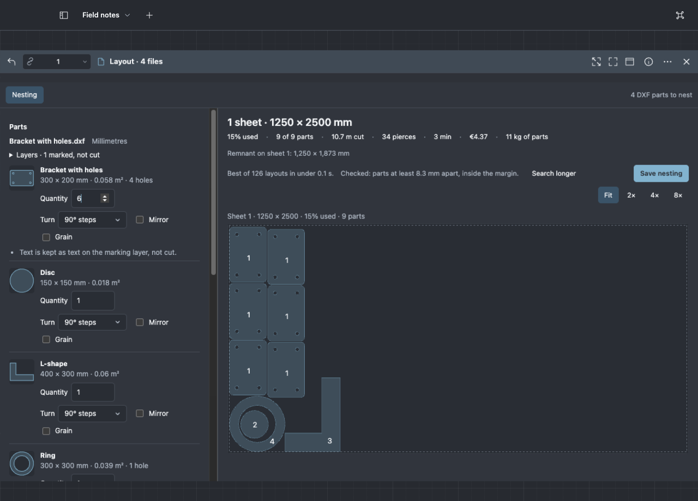

# Lay out photos and PDFs

Select photos or PDFs, press **⌘K** and choose **Lay out…**. It is also in the file menu, under
**Suggested** for several photos. Viewer chooses a layout for what you selected and opens it in a
Layout plane. The preview is the file it saves.

Across the top, the plane offers the modes that suit the selection, the suggested one first. Under
the preview, the suggested layouts are ranked, each with the reason it fits, such as "Fills A4
landscape, no cropping". Choose one to use it.

## Make a collage

1. Select two to nine photos and choose **Lay out…**. The plane opens on **Collage**, with the best
   layout chosen.
2. Pick a suggested layout, or choose a **Style**: **Rows**, **Featured**, **Grid**, **Strip**, and
   **Halves** or **Thirds** for two or three photos.
3. Under **Photos**, **Fill** crops each photo to its frame and **Whole** shows each photo uncut.
   With **Fill**, **Keep** chooses the part of each photo that stays: the centre, top, bottom, left
   or right.
4. Under **Page**, **Fit the photos** shapes the picture to the photos, at their own resolution, and
   prefers print and screen proportions (from square to 16:9) to long strips. You can also choose a
   paper size such as A4, a print size such as 10 × 15 cm, or a screen size such as 1080 × 1350 px.
5. Set the **Margin**, the **Gap** and the **Background**. **Transparent** leaves a PNG clear around
   the photos.
6. Choose **JPEG**, **PNG** or **PDF**, check the **Name** and choose **Save**.

**Featured** gives one photo most of the page; **Large photo** chooses which.

## Make a contact sheet

1. Select ten or more photos and choose **Lay out…**. The plane opens on **Contact sheet**.
2. Keep **Columns** on **Automatic**, or choose a number. The summary shows how many pages that
   makes.
3. Turn **Folder name**, **Date** and **Size** on or off for the captions.
4. Choose **Save PDF**. Every page is numbered.

## Print several pages on one sheet

1. Select a PDF and choose **Lay out…**. A5 and A6 pages open on **N-up**, as many to an A4 sheet as
   print at nine tenths of their size or more.
2. Choose **Pages per sheet**: 2, 4, 6, 8, 9 or 16. Viewer turns the sheet, and the pages when it
   must, so they print as large as they can.
3. Under **Order**, choose **Across** or **Down**.
4. Turn on **Crop marks** or **Frame lines** if you will cut the sheets. For pages that carry bleed,
   set **Bleed in the pages**: it is cut away at the crop marks.

Pages of different sizes are each scaled into their own place on the sheet.

## Make a booklet

1. Select a PDF of four pages or more, choose **Lay out…**, then **Booklet**.
2. Viewer orders the pages for folding and adds blank pages at the end to make a multiple of four.
   The summary shows the sheets and pages.
3. For a thick booklet, set **Creep per sheet** to about the thickness of the paper, 0.1 mm for
   office paper. Inner sheets then move their pages toward the fold.
4. Choose **Save PDF**.
5. Print it on both sides, flipping on the short edge. Fold the stack in half and staple along the
   fold. The plane shows the same instructions.

## Print cards, labels and passport photos

1. Select a card-sized PDF, or one photo, and choose **Lay out…**. The plane opens on **Step and
   repeat**.
2. Choose the **Item**: business cards of 85 × 55 mm or 3.5 × 2 in, passport photos of 35 × 45 mm or
   2 × 2 in, photo prints, a label sheet, **Actual size**, or **Custom size**.
3. Keep **Fill the sheet**, or turn it off and set **Copies of each**. The summary shows how many
   fit on a sheet and how many sheets you need.
4. **Turn items to fit more** lets Viewer turn some items on their side when more then fit.
5. Under **Marks**, choose **Crop marks** at each item's corners, or **Cut lines** in the margins
   for items placed edge to edge.
6. Choose **Save PDF** and print it at 100%.

A label sheet places each label where the labels are on the sheet: 21, 14 or 65 on A4, or 30 on
Letter.

## Print a poster on ordinary sheets

1. Select a large PDF page, such as an A1 plan, or a photo, and choose **Lay out…**, then
   **Poster**.
2. Choose the **Poster size**: **Scale**, a percentage of the page's own size, or A3 to A0.
3. Set the **Overlap** that neighbouring sheets share. The summary shows how many sheets the poster
   takes and how they are arranged.
4. Choose **Save PDF** and print it at 100%.
5. Each sheet is labelled in its corner: a row letter and a column number, A1 at the top left. Trim
   each sheet after the first at the solid marks, then glue it over the dashed overlap of its
   neighbour.

## Nest parts for cutting

1. Select DXF parts, press **⌘K** and choose **Nest for cutting…**. The Layout plane opens on
   **Nesting** and lists each part with its picture, size and area.
2. Type each part's **Quantity**. The headline answers at once with a box estimate, such as "About 4
   sheets · 1250 × 2500 mm". The true-shape result replaces it within seconds and improves while the
   search runs.
3. Choose how far each part may **Turn**: **As drawn**, **90° steps**, **45° steps**, **15° steps**
   or **Free (5° steps)**. Turn on **Mirror** for parts that may be flipped, and **Grain** for parts
   that must keep their direction along the sheet.
4. If a drawing holds several outlines, choose **Separate parts** or **One part**. Under **Layers**,
   mark engraving and text layers **mark only**: they are drawn but not cut. Layers named like
   ENGRAVE, MARK, ETCH or TEXT are marked already. A drawing that does not say its units shows
   **Units not given**: choose them.
5. Under **Sheets**, turn on every format you can use, with its **In stock** count and **Price
   each**, or **Add size** for your own. Set the **Edge margin** and the **Spacing** between parts.
6. Under **Cutting**, choose the **Material** and thickness, then adjust **Speed**, **Pierce** and
   **Machine rate** to your machine.
7. Read the advice under the headline: which format needs the fewest sheets or costs least, parts
   that fit no sheet, and how many sheets more turning would save. **Fit**, **2×**, **4×** and
   **8×** zoom the sheets.
8. When the headline says **Checked**, choose **Save nesting**. A folder such as "Nesting of 3
   parts" appears beside the first drawing, holding `Sheet 1.dxf` for each sheet, `Report.pdf` and
   `Parts.csv`. **Open folder** shows it.

**Stop** keeps the best layout so far; **Search longer** looks again for longer. The
[nesting reference](../reference/nesting.md) explains the search, the estimate formulas and the
saved files exactly.

## What is saved

- The plane uses photos, PDFs and DXF parts. It names any file it leaves out and why: a file over
  256 MB, or a PDF locked with a password.
- **Save** writes a new file in the folder of the first file you selected and leaves the originals
  as they were. If the name is taken, Viewer chooses a free one. **File operations** in the title
  bar shows its progress and offers Undo.
- A JPEG or PNG holds one page without PDF pages. Layouts of PDF pages, and layouts of several
  pages, are saved as PDF.
- On a paper size, **Resolution** sets the pixels of a JPEG or PNG. A fitted collage takes the
  photos' own resolution, and a screen size is saved at exactly its pixels.

The [layout reference](../reference/layout.md) lists the page sizes, limits and what the saved file
contains.
