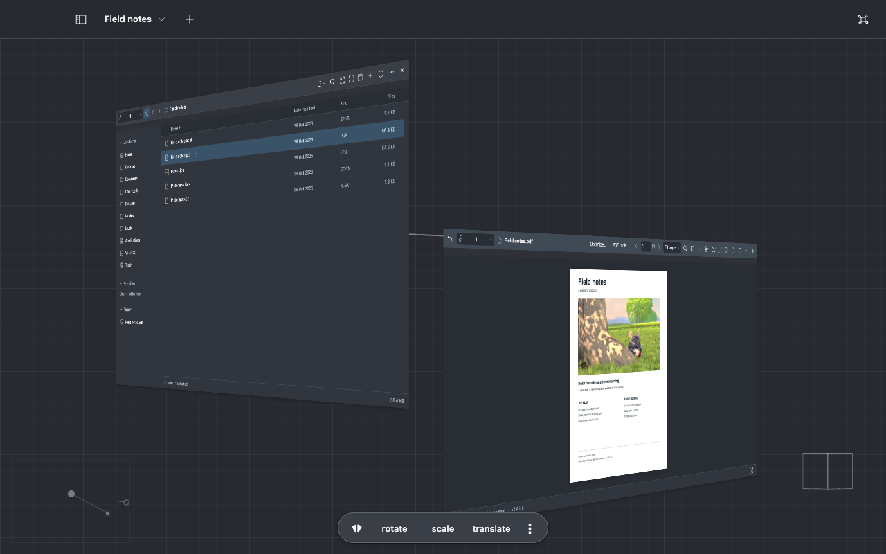

# Keep your work together

Use this guide when one task needs several things open at once: a folder, the files you read from
it, notes and tools. It shows how to arrange [planes](../reference/terms.md#planes-and-the-space),
save views, show someone around with a tour, keep separate workspaces, share a project folder and
back up your work.

**Find it:** **⌘0** shows every plane, **⌘Return** docks one · the workspace's name at the top left
of the window · **Workspace** in the menu bar · **File → Create Project…**

A workspace is a set of planes and where you put them. Viewer saves it as you go, so the same
folders, files and tools are there when you come back. Your files stay in their ordinary folders.

## Open a second plane

- In Quick Preview, choose **Open linked plane**, or **Option**-double-click a file. The new plane
  is a child of the folder it came from, and a line joins them: a
  [linked plane](../reference/terms.md#planes-and-the-space).
- Choose **Open in another plane** for a separate folder plane with its own history.
- **Related planes** in a plane's header lists its parent and children. Closing a child returns you
  to its parent.

Opening a file that already has a plane in the same branch shows that plane again.

A [root plane](../reference/terms.md#planes-and-the-space), such as one from **Open in another
plane**, **New folder plane** or a tour's stop, opens beside the plane you are working in. It faces
the same way, to the right when there is room there, otherwise to the left, below or above. The
planes already open stay where they are, and closing a plane leaves the rest in place. Root planes
then keep their size when the window changes; **⌘0** frames them all again.

## Move between planes

| To                                   | Do                                                |
| ------------------------------------ | ------------------------------------------------- |
| See every plane                      | **⌘0** (**Frame all planes**)                     |
| Give one plane the whole window      | **⌘Return**, or **Dock plane** in its header      |
| Lay the planes out face-on           | **⌘K** → **Tile the planes in view**              |
| Go to the parent plane               | **⌥⌘↑** (**Back to parent plane**)                |
| Close a plane                        | **⌥⌘W**, or **×** in its header                   |
| Undo a move, resize or close         | **⌥⌘Z**; **⌥⇧⌘Z** redoes it                       |
| Hide the window's chrome for a while | **⌘⇧F** (**Focus mode**); press it again to leave |

In the spatial view, click inside a plane to scroll it and type into it. Click the background or
press **Escape** to move around the space again. Drag a plane by its header.

The minimap appears once three planes are open, to find one among them. **Settings → Space** shows
it always (turn off **Minimap only with 3 or more planes**), and adds the space toolbar and the
viewcube (**Show space toolbar**, **Show viewcube**).

**⌥⌘Z** only undoes arrangement. File changes have their own **⌘Z**; see
[Browse and organize](files.md#copy-move-and-rename).

## Choose the title bar icons

Open **Settings → Space → Title bar icons**. Toggle **Window navigation**, **New folder plane**,
**File operations**, **Microphone** and **Commands** individually. The microphone starts hidden.
Their commands and keyboard shortcuts remain available when an icon is hidden.

Click the workspace name in the title bar to choose another workspace directly. **New workspace…**,
**Rename workspace…**, **Workspace look…** and **Delete workspace…** follow the workspace list.

## Choose a plane's header buttons

A plane's header starts with its everyday buttons: back and forward, the view, search, **Frame
plane**, **Dock plane**, the actions menu (**…**) and **×**. Every other command is in **…**, which
ends with **What can I do here?**.

In a narrow plane, the buttons that no longer fit move to the top of **…**, and come back as the
plane widens. **Frame plane**, **Dock plane**, **…** and **×** always stay in the header.

1. Open **Settings → Space → Plane toolbar**.
2. Choose **Buttons → Full** to add **Layout**, **What can I do here?** and each file's full set of
   tools, such as a PDF's **Show pages** and **Print…**. **Buttons → Essential** goes back.
3. Turn single buttons on or off below it. **Buttons** then reads **Custom**.

**⌘K** → **Plane toolbar: Full** or **Plane toolbar: Essential** does the same from the workspace.
While a profile is in use, the choice is this workspace's own. The **Full** profile shows every
button.

A hidden button keeps its command: **…**, **⌘K** and its shortcut still reach it. To put a tool you
use often in the header, pin it in **What can I do here?**. A text plane starts with **Edit text**
pinned.

## Save a view and return to it

1. Arrange the planes and camera the way you want.
2. Press **⌃⌥⌘1** to save the view in slot 1, up to **⌃⌥⌘9**, or choose **Save view…** to name it.
3. Press **⌥⌘1** to fly back to slot 1. **⌘K** → **Views…** lists every saved view.

**Save layout as template…** keeps the arrangement of plane kinds, so you can apply it to other
folders.

## Show someone around: tours

A tour shows files one stop at a time, each opened at the place that matters: a page, an outline on
a drawing, the holes in a DXF, a model from one side. It is a `.viewer-tour.jsonc` file kept beside
those files, so it travels with their folder.

**Record a tour**

1. Choose **⌘K** → **Record a tour**. The tour stops panel opens.
2. Open a file and show the place to point at: turn to the page, zoom into part of a photo, frame
   the holes in a drawing or turn the model.
3. Choose **Add “Bracket.pdf”** (the button names the active file). The stop keeps where the preview
   is, and its caption names the file and the place, such as `Bracket.pdf, page 2`. A photo or
   drawing shown whole adds the file without a place.
4. Write each caption, or choose **Dictate** beside it. The up and down buttons change the order.
5. Choose **Play** to try the tour, then **Save tour**. It saves in the folder that holds every
   stop's file, under the tour's name.

**Play a tour**

1. Open its `.viewer-tour.jsonc` file. It plays at once. It opens files and moves the camera; it
   never runs commands.
2. Read the tour bar: the caption, the file and the place in it, and how far along you are.
3. Press **→** and **←** to move between stops, **Space** to pause and **Escape** to stop. On a
   focused button, **Space** presses the button. A click or scroll in the space pauses the tour
   while you look around; **Resume** brings the stop back into view. Paused, the tour stays at its
   stop, even one it is skipping.
4. At the end, only **Escape** belongs to the tour; every other key is the window's again. Switching
   to or deleting the workspace it plays in stops it.

**Profile: Present** plays the tour opened last, or your saved views when no tour is open. **Tour
the views** (prefix **b** then **t**) always tours the saved views. **Edit tour “…”** in **⌘K**, or
**Edit stops** at the end of a tour, reopens its stops.

| When a stop's file                   | The tour                                                                                            |
| ------------------------------------ | --------------------------------------------------------------------------------------------------- |
| Is gone                              | Names the file, then skips the stop                                                                 |
| Changed since the stop was recorded  | Opens it as it is now, without the stop's place or the last stop's mark: **Changed since recorded** |
| Was copied with its folder elsewhere | Opens it as recorded: its bytes, or else its size and date, match the recording                     |
| Is reached through a link            | Skips the stop: a tour shows only files stored in its own folder                                    |
| Is in a folder Viewer may not read   | Says so and skips the stop; allow the folder in the folder picker, then play the tour again         |
| Is closed while its stop shows       | Says so, then goes on to the next stop                                                              |
| Was made by a check or a model       | Shows the finding's grade: **Confirmed**, **Refuted** or **Unverified**                             |

A stop never opens a tour or project file, so a tour cannot play another tour or install a project.
When the tour moves on, the outline or highlight a stop drew in a file goes with it.

Each stop shows for at least **Settings → Space → Tour → Time at each view (ms)**, longer when its
caption needs more time to read. [Tour files](../reference/configuration.md#tour-files) gives the
exact format.

## Use several workspaces

Choose the workspace's name at the top left of the window. Up to five recent workspaces appear above
the full action menu, with a check beside the current workspace. **Manage workspaces…** opens the
complete list: search by name, sort by recent use or name, and browse 25 at a time. Open, rename or
delete a workspace from its row, or choose **New workspace…**. A workspace open in another window is
managed from that window. Viewer remembers recent use across restarts.

**Workspace → New Workspace…** in the menu bar also creates a workspace. Give each kind of work its
own: a writing workspace with a folder, a PDF and notes; a project workspace with an editor, a
terminal and a browser. Choose where new folder planes open in **Settings → Browsing → New folder
planes start in**.

## Share a project folder

**File → Create Project…** writes `viewer.project.jsonc` into a folder. It records which files are
open and how they are arranged, using paths relative to that folder, so the project opens the same
way on another computer. It never copies your files, terminal history, conversations or keys. Open
it again with **File → Open Project…**; **File → Save Project** records later changes.

## Back up and restore your work

1. Choose **Workspace → Backup and Restore…**, then **Create backup…**.
2. Check the workspace and document counts, then choose **Save backup…**.
3. On the other computer, choose **Open backup…**, relink any folder that moved, then choose
   **Restore copies**.

The backup holds your notes, drafts, conversations, file paths and command history, so keep it
private. It does not hold your files, keys, folder permissions or browser sessions. Restored
terminals, servers and conversations stay stopped until you start them.
[Personal backups](../reference/configuration.md#personal-backups) lists the exact contents.

## What closing a plane does

| Plane          | Closing it                                                            |
| -------------- | --------------------------------------------------------------------- |
| A preview      | Keeps the file                                                        |
| A note         | Keeps the note; reopen it from **Notes…**                             |
| A terminal     | Ends its shell                                                        |
| A local server | Keeps the server running; reopen its controls from **Local servers…** |

When Viewer restarts, it reopens your planes but never reruns terminal input, commands, agents or
servers.
