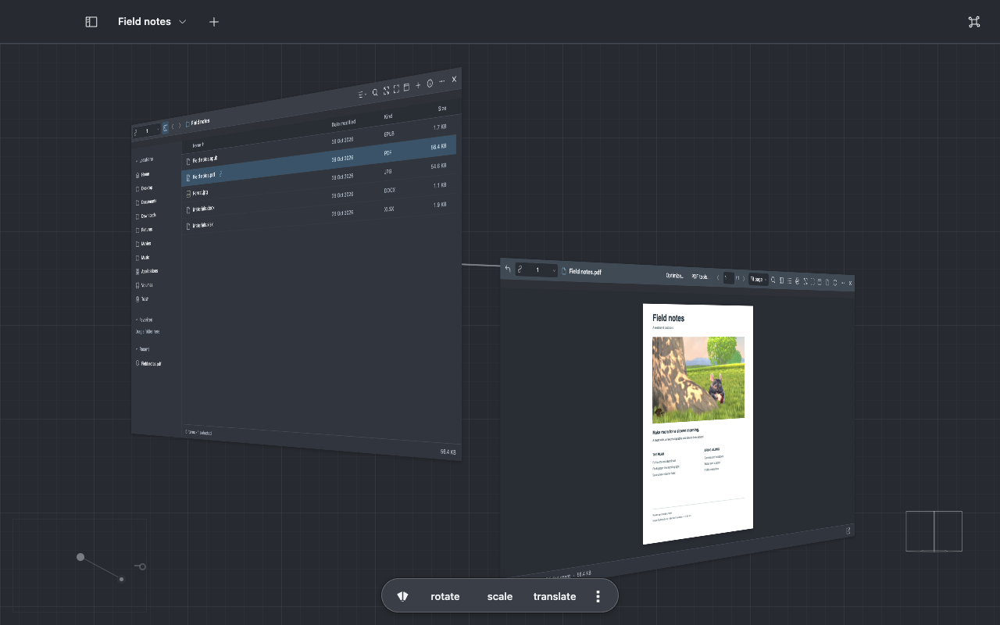

# Keep your work together

Use this guide when one task needs several things open at once: a folder, the files you read from
it, notes and tools. It shows how to arrange [planes](../reference/terms.md#planes-and-the-space),
save views, show someone around with a tour, keep separate workspaces, share a project folder and
back up your work.

**Find it:** **⌘0** shows every plane, **⌘Return** docks one · the workspace's name at the top left
of the window · **Workspace** in the menu bar · **File → Create Project…**

A workspace is a set of planes and where you put them. Viewer saves it as you go, so the same
folders, files and tools are there when you come back. Your files stay in their ordinary folders.

## Open a second plane

- In Quick Preview, choose **Open linked plane**, or **Option**-double-click a file. The new plane
  is a child of the folder it came from, and a line joins them: a
  [linked plane](../reference/terms.md#planes-and-the-space).
- Choose **Open in Another Plane** for a separate folder plane with its own history.
- **Related planes** in a plane's header lists its parent and children. Closing a child returns you
  to its parent.

Opening a file that already has a plane in the same branch shows that plane again.

A [root plane](../reference/terms.md#planes-and-the-space), such as one from **Open in another
plane**, **New Folder Plane** or a tour's stop, opens beside the plane you are working in. It faces
the same way, to the right when there is room there, otherwise to the left, below or above. The
planes already open stay where they are, and closing a plane leaves the rest in place. Root planes
then keep their size when the window changes; **⌘0** frames them all again.

## Move between planes

| To                                   | Do                                                |
| ------------------------------------ | ------------------------------------------------- |
| See every plane                      | **⌘0** (**Frame All Planes**)                     |
| Give one plane the whole window      | **⌘Return**, or **Dock plane** in its header      |
| Lay the planes out face-on           | **⌘K** → **Tile the Planes in View**              |
| Go to the parent plane               | **⌥⌘↑** (**Back to parent plane**)                |
| Close a plane                        | **⌥⌘W**, or **×** in its header                   |
| Undo a move, resize or close         | **⌥⌘Z**; **⌥⇧⌘Z** redoes it                       |
| Hide the window's chrome for a while | **⌘⇧F** (**Focus Mode**); press it again to leave |

In the spatial view, click inside a plane to scroll it and type into it. Click the background or
press **Escape** to move around the space again. Drag a plane by its header. **Shift**, **⌘** or
**Ctrl**-click the header to toggle plane selection. Modified clicks and drags inside the content
belong to the content, so selecting files or text keeps working.

The minimap appears once three planes are open, to find one among them. **Settings → Space** shows
it always (turn off **Minimap only with 3 or more planes**), and adds the space toolbar and the
viewcube (**Show space toolbar**, **Show viewcube**).

Choose **Minimap corner** beside **Show minimap** to keep the map in one corner. **Automatic**, the
default, moves it clear of plane controls. A fixed corner stays put even when controls overlap it.
Overview uses the chosen corner too. The viewcube moves aside for a fixed-corner minimap when
conceal is off. A concealed viewcube stays in its corner when you hover to reveal its controls, even
if it overlaps the fixed minimap.

Choose **⌘K → Overview** to navigate the space, even with **Show minimap** off or fewer than three
planes. Press **Escape**, click outside, choose a plane or run **Overview** again to close it. The
minimap returns to its previous visibility without changing its settings. In an empty space,
Overview says **Open a plane first.** If a plane is docked, choose **Reveal Space** (**⌘Return**)
first.

**⌥⌘Z** only undoes arrangement. File changes have their own **⌘Z**; see
[Browse and organize](files.md#copy-move-and-rename).

## Keep notes and checks visible

Focus a note or check, then choose **⌘K → Pin Plane**. It stays beside the space while you move
between files. **Collapse Pinned Plane** leaves its title visible; **Expand Pinned Plane** brings
its contents back. **Place in Space** returns it to the canvas.

A laser-job check opens pinned. Choose **Compare Evidence** in the check to arrange its sources
beside it. Finishing a check leaves your existing arrangement in place until you ask to compare.

## Stack related planes

Select two to twelve planes by **Shift**, **⌘** or **Ctrl**-clicking their title bars, then choose
**⌘K → Stack Selected Planes**. Pinned planes must first be placed in the space. To separate a
stack, focus one of its planes and choose **Unstack Planes**. Each plane returns to its previous
position.

**⌥⌘Z** undoes stacking and **⌥⇧⌘Z** redoes it. Viewer saves pins, collapsed titles, stack
membership and return positions across restarts. In a check, **Restore Arrangement** returns the
evidence planes to where they were before the comparison.

## Choose the title bar icons

Open **Settings → Space → Title bar icons**. Toggle **Window navigation**, **New Folder Plane**,
**File operations**, **Microphone** and **Commands** individually. The microphone starts hidden.
Their commands and keyboard shortcuts remain available when an icon is hidden. Settings focuses its
search field when opened; reopening selects the previous query so you can replace it.

Click the workspace name in the title bar for recent workspaces and the full action menu. **Manage
workspaces…** searches the complete workspace list.

## Choose a plane's header buttons

A plane's header starts with its everyday buttons: back and forward, the view, search, **Frame
plane**, **Dock plane**, the actions menu (**…**) and **×**. Every other command is in **…**, which
ends with **What Can I Do Here?**.

In a narrow plane, the buttons that no longer fit move to the top of **…**, and come back as the
plane widens. **Frame plane**, **Dock plane**, **…** and **×** always stay in the header.

1. Open **Settings → Space → Plane toolbar**.
2. Choose **Buttons → Full** to add **Layout**, **What Can I Do Here?** and each file's full set of
   tools, such as a PDF's **Show pages** and **Print…**. **Buttons → Essential** goes back.
3. Turn single buttons on or off below it. **Buttons** then reads **Custom**.

**⌘K** → **Plane toolbar: Full** or **Plane toolbar: Essential** does the same from the workspace.
While a profile is in use, the choice is this workspace's own. The **Full** profile shows every
button.

A hidden button keeps its command: **…**, **⌘K** and its shortcut still reach it. To put a tool you
use often in the header, pin it in **What Can I Do Here?**. A text plane starts with **Edit Text**
pinned.

## Save a view and return to it

1. Arrange the planes and camera the way you want.
2. Press **⌃⌥⌘1** to save the view in slot 1, up to **⌃⌥⌘9**, or choose **Save View…** to name it.
3. Press **⌥⌘1** to fly back to slot 1. **⌘K** → **Views…** lists every saved view.

**Save Layout as Template…** keeps the arrangement of plane kinds, so you can apply it to other
folders.

## Show someone around: tours

A tour shows files one stop at a time, each opened at the place that matters: a page, an outline on
a drawing, the holes in a DXF, a model from one side. It is a `.viewer-tour.jsonc` file kept beside
those files, so it travels with their folder.

**Record a Tour**

1. Choose **⌘K** → **Record a Tour**. The tour stops panel opens.
2. Open a file and show the place to point at: turn to the page, zoom into part of a photo, frame
   the holes in a drawing or turn the model.
3. Choose **Add “Bracket.pdf”** (the button names the active file). The stop keeps where the preview
   is, and its caption names the file and the place, such as `Bracket.pdf, page 2`. A photo or
   drawing shown whole adds the file without a place.
4. Write each caption, or choose **Dictate** beside it. The up and down buttons change the order.
5. Choose **Play** to try the tour, then **Save Tour**. It saves in the folder that holds every
   stop's file, under the tour's name.

**Play a tour**

1. Open its `.viewer-tour.jsonc` file. It plays at once. It opens files and moves the camera; it
   never runs commands.
2. Read the tour bar: the caption, the file and the place in it, and how far along you are.
3. Press **→** and **←** to move between stops, **Space** to pause and **Escape** to stop. On a
   focused button, **Space** presses the button. A click or scroll in the space pauses the tour
   while you look around; **Resume** brings the stop back into view. Paused, the tour stays at its
   stop, even one it is skipping.
4. At the end, only **Escape** belongs to the tour; every other key is the window's again. Switching
   to or deleting the workspace it plays in stops it.

**Profile: Present** plays the tour opened last, or your saved views when no tour is open. **Tour
the views** (prefix **b** then **t**) always tours the saved views. **Edit Tour “…”** in **⌘K**, or
**Edit stops** at the end of a tour, reopens its stops.

| When a stop's file                   | The tour                                                                                            |
| ------------------------------------ | --------------------------------------------------------------------------------------------------- |
| Is gone                              | Names the file, then skips the stop                                                                 |
| Changed since the stop was recorded  | Opens it as it is now, without the stop's place or the last stop's mark: **Changed since recorded** |
| Was copied with its folder elsewhere | Opens it as recorded: its bytes, or else its size and date, match the recording                     |
| Is reached through a link            | Skips the stop: a tour shows only files stored in its own folder                                    |
| Is in a folder Viewer may not read   | Says so and skips the stop; allow the folder in the folder picker, then play the tour again         |
| Is closed while its stop shows       | Says so, then goes on to the next stop                                                              |
| Was made by a check or a model       | Shows the finding's grade: **Confirmed**, **Refuted** or **Unverified**                             |

A stop never opens a tour or project file, so a tour cannot play another tour or install a project.
When the tour moves on, the outline or highlight a stop drew in a file goes with it.

Each stop shows for at least **Settings → Space → Tour → Time at each view (ms)**, longer when its
caption needs more time to read. [Tour files](../reference/configuration.md#tour-files) gives the
exact format.

## Use several workspaces

Choose the workspace's name at the top left of the window. Up to five recent workspaces appear above
the full action menu, with a check beside the current workspace. **Manage Workspaces…** opens the
complete list. **Open** lists your open workspaces; **Defined** searches definitions, sorts by
recently opened or key, and shows 25 per page. Open, rename or close a defined workspace from its
row; delete an ad-hoc workspace or choose **New Workspace…**. A workspace open in another window is
managed from that window. Viewer remembers recent use across restarts.

**Workspace → New Workspace…** in the menu bar also creates a workspace. Give each kind of work its
own: a writing workspace with a folder, a PDF and notes; a project workspace with an editor, a
terminal and a browser. Choose where new folder planes open in **Settings → Browsing → New folder
planes open at**.

## Workspaces Viewer finds

Choose **⌘K → Change Workspace…** or **Manage Workspaces… → Defined** and search for a folder you
use. **Found** marks a workspace Viewer recognized from your private folder history or open planes.
Its detail shows the root folder. Opening it adds one folder plane; Close and reopen work as for
other defined workspaces. It joins **Recently closed** only after Viewer remembers its planes. Found
workspaces have no written entry to save over.

Viewer recognizes Git roots, workspace markers and common language manifests. An outer Git
repository holds its nested packages together. If it contains two or more inner Git repositories
Viewer has seen, those repositories become separate workspaces. A Makefile, justfile or Procfile
alone does not make a workspace. Home, its standard top-level folders, hidden folders, Library,
dependency trees, app bundles and network volumes stay out.

Finding runs quietly after folder history is ready. It never delays launch, asks for access or runs
a command. Three visits within a root, with the newest in the last 90 days, qualify it; a plane in a
recently used workspace also qualifies. Handwritten and VS Code definitions take precedence for the
same root. A workspace found on a disk that is not connected stays listed for 90 days after you last
used it, or while it is open or remembers planes.

Turn off **Settings → Browsing → Suggest workspaces from folders you open** to stop finding and
clear its cached entries and probes. **Clear Recent Folders** clears those too, keeping workspaces
that are linked open or remember planes, including older remembered planes. Undoing the clear
restores the visits that let Viewer find those folders again. Unchanged paths and definitions keep
the same keys. Found metadata stays on this Mac and is excluded from backups, project exports and
agents. The Store edition uses only folders whose access is already active. A folder granted
directly can itself be a workspace root.

To hide a found workspace, choose **Not a Workspace** on its row in **Manage Workspaces… →
Defined**. It leaves search, Manage and the workspace card at once, and **Undo** in the list's
footer brings it back for eight seconds. Close a found workspace before hiding it. Folders inside a
hidden root can still be found as workspaces of their own. Hidden roots stay hidden through **Clear
Recent Folders** and while finding is off. Below the finding switch, **Settings → Browsing** counts
them, such as `12 found · 2 hidden`; **Show Hidden Again** brings every hidden root back.

## Open the workspace a folder belongs to

When you browse a folder inside a defined or found workspace, the first of your folder planes inside
its root shows a card after any first-run tips:

| Card                                 | Shows when                                          | Action             |
| ------------------------------------ | --------------------------------------------------- | ------------------ |
| “acme-site” remembers 5 planes       | Viewer remembered its planes when you closed it     | **Open Workspace** |
| “acme-site” opens 3 planes           | Its definition opens more than a folder at its root | **Open Workspace** |
| “acme-site” is open in “Workspace 3” | Another workspace is linked to it                   | **Switch**         |

The card names the innermost workspace holding the folder and shows its root. A workspace that only
opens a folder at its root shows no card, since you are already browsing there. No card shows in the
workspace linked to it, or in one whose planes are mostly inside its root: two or more planes and at
least 60% of them, or its only plane. The card is one of the three insight cards and follows
**Settings → Browsing → Suggestions → Show folder insights**. Choose **×** to hide it for that root;
**⌘K** → **Show Hidden Insights** brings it back. Until you hide it, **⌘K** with nothing typed lists
the same workspace under **Suggested** with the same reason, such as **Remembers 5 planes**.

## Open a defined workspace

1. Choose **⌘K** → **Change Workspace…**.
2. Type a name, alias or definition key, such as `sample/tools/sample-cli`.
3. Choose the workspace. Viewer opens its planes, or focuses its window if it is already open.

Matches keep their ranked order. Open workspaces lead within the same match band. With no search,
the picker shows open workspaces, up to eight recently opened definitions and the total available to
search. While fewer than eight show, up to three found workspaces you have not opened fill the list,
most used first. A search shows up to 50 defined matches, with **N more · keep typing** when more
match. In the main **⌘K** palette, open workspaces match from one character; definitions need at
least two. **All N matching workspaces** opens the workspace search.

Viewer asks before reading VS Code Project Manager’s list. If a list is found, **Manage workspaces…
→ Defined** offers **Use VS Code Projects** and **Don’t Use**. The **Use VS Code Project Manager’s
projects…** row in Change workspace opens that tab without deciding. Nothing is read or counted
until you choose Use, and Viewer never changes the list.

Change the choice with **Settings → Configuration → Workspace definitions → Use VS Code Project
Manager projects**. In the Store edition, choosing Use asks for folder access. If declined, **Allow
access…** lets you try again. Projects appear as plain definitions and join the open list only when
opened. Turning the switch off leaves open workspaces open and keeps their definition links. Choose
Use again to restore the projects. While the source is not in use, Close stays available and Delete
stays unavailable for workspaces linked to its projects.

Definitions marked hidden and definitions whose root folder is missing stay out of search. Missing
and unknown roots among search candidates are checked again when you search and when mounted volumes
change. Catalog loading does not wait for folder checks.

To customize a definition, choose **⌘K** → **Edit Workspace Definitions**. This creates a commented
`workspaces.jsonc` only if it is absent, then opens it in your editor. Add an entry with the
project's key to override its name or planes.
[Workspace definitions](../reference/configuration.md#workspace-definitions) lists the fields,
tokens and limits. **Settings → Configuration → Workspace definitions → Validate** shows problems
with line numbers. A broken document keeps the last valid copy in effect.

Definitions accept terminal `command` fields. A waiting terminal shows the definition's current
command when the plane at that index is still a terminal whose folder resolves to this pane's
folder. **Run** runs that displayed command; **Shell only** starts a shell without it. Otherwise the
panel says **This terminal changed in the definition.** and offers **Reset to Definition…** and
**Shell only**. **Run all** skips changed terminals and reports their outcome on each plane. New or
changed commands also need native approval. Plain terminal planes keep their normal behavior.
Editing a definition never rearranges an open workspace.

| Term                             | What opening it does                                                                                                                                                                  |
| -------------------------------- | ------------------------------------------------------------------------------------------------------------------------------------------------------------------------------------- |
| Layout template                  | Adds its planes to the workspace you are in.                                                                                                                                          |
| Workspace definition             | Opens a whole workspace by name and root. It stays out of the open list until opened. Command terminals offer Run, Shell only and Run all, with approval for new or changed commands. |
| Project (`viewer.project.jsonc`) | Opens an arrangement shared with a folder. It never starts commands.                                                                                                                  |

## Close and remember a workspace

Choose **Workspace → Close Workspace** for a workspace opened from a definition. Viewer remembers
its planes, tiling, focus and preview positions. Running terminals ask before closing; their shells
stop. Unsaved editors and scratch text ask **Save**, **Don’t Save** or **Cancel**. Cancel leaves the
workspace open. Open it again by name to restore its planes. Terminals reopen stopped.

The workspace menu shows up to three **Recently closed** definitions below the recent open
workspaces. In **Manage Workspaces… → Defined**, **Remembers** marks a closed workspace’s saved
snapshot. **Forget remembered planes** asks before removing that snapshot; the next open builds from
the definition. Viewer keeps up to 100 snapshots, dropping the oldest if they exceed 16 MB. If one
workspace alone exceeds the limit, Close explains that Viewer cannot remember its planes and asks
before closing it. Snapshots stay on this computer and are excluded from personal backups and agent
discovery.

## Reset or save a definition

- **Reset to Definition…** replaces the open planes with the definition's planes. The confirmation
  counts what closes and opens. Unsaved editors ask before anything closes; Cancel keeps the
  workspace open. Command terminals remain stopped and ask before running.
- **Save to Definition** (also found as **sync**) writes the supported planes, their order, tiling
  and focus to this workspace's entry. A curated or changed definition, or a save that removes a
  command, asks once: **Save over definition**. Saving immediately after opening leaves the entry
  unchanged. Comments on unchanged planes stay with them; planes skipped at open stay written. If
  the definition changed, planes present only in the file stay written, including planes you closed
  here.
- **Save as Definition…** links an ad-hoc workspace to a new definition. Review the proposed **Key**
  and **Name**. A project owning most planes supplies the proposed key; otherwise Viewer uses the
  workspace's name and common folder. An existing entry must use **Save to Definition**.

Manage's **Open** tab offers **Close** for defined workspaces and **Delete** for ad-hoc workspaces.
The **Defined** tab shows **Remembers**, **Rich**, **Curated**, **Hidden** and **Folder missing**
badges. Its problem disclosure shows diagnostics without covering the list.

If a valid catalog no longer contains a standalone definition’s key, its row says the definition was
removed. **Delete** and **Save as Definition…** become available. Project Manager and override links
stay protected while their source is not in use. A found link waits for finding to finish, then says
**Viewer no longer finds this folder.** if its root is no longer found. A broken file keeps the
link.

Editing a definition never rearranges an open workspace. **Definition changed** in Manage and the
switcher offers **Reset to Definition…**. Remembered planes take precedence on reopen even when the
definition changed; a notice offers Reset. A waiting command terminal shows and runs the
definition's current command when that indexed terminal still names the same folder. Otherwise it
says **This terminal changed in the definition.** with **Reset to Definition…** and **Shell only**.

## Share a project folder

**File → Create Project…** writes `viewer.project.jsonc` into a folder. It records which files are
open and how they are arranged, using paths relative to that folder, so the project opens the same
way on another computer. It never copies your files, terminal history, conversations or keys. Open
it again with **File → Open Project…**; **File → Save Project** records later changes.

## Back up and restore your work

1. Choose **Workspace → Backup and Restore…**, then **Create Backup…**.
2. Check the workspace and document counts, then choose **Save Backup…**.
3. On the other computer, choose **Open Backup…**, relink any folder that moved, then choose
   **Restore Copies**.

The backup holds your notes, drafts, conversations, canvases, attached canvas assets, file paths and
command history, so keep it private. Restored copies have no definition link. It does not hold other
source files, keys, folder permissions or browser sessions. Restored terminals, servers and
conversations stay stopped until you start them.
[Personal backups](../reference/configuration.md#personal-backups) lists the exact contents.

## What closing a plane does

| Plane          | Closing it                                                            |
| -------------- | --------------------------------------------------------------------- |
| A preview      | Keeps the file                                                        |
| A note         | Keeps the note; reopen it from **Notes…**                             |
| A check        | Keeps its result; reopen it with **Check Laser Job…** for that job    |
| A terminal     | Ends its shell                                                        |
| A local server | Keeps the server running; reopen its controls from **Local Servers…** |

When Viewer restarts, it reopens your planes but never reruns terminal input, commands, agents or
servers. Opening a defined workspace asks before each command its definition names.
