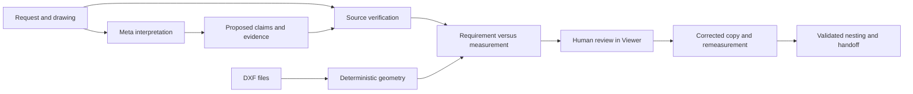

# Ecosystem review and Workshop implementation plan

Viewer Workshop connects a fabrication request, drawing and CAD parts to a reviewed correction and
an exported handoff. This page records the design decisions from the ecosystem audit. Current
behavior belongs in the [fabrication reference](../reference/fabrication.md); run evidence belongs
with the retained test and evaluation artifacts. Implementation does not establish live-model
accuracy, registry publication or submission readiness.

## Product direction

Plurid keeps spatial planes in the DOM. Viewer uses that foundation for file browsing, creative work
and development. Workshop should prove why keeping related sources together helps a person finish a
concrete job.

The demonstration uses generated Job 1042. Its drawing specifies a 50 mm hole pitch; its original
DXF measures 48 mm. The person can inspect both, review a corrected copy, remeasure it and export a
handoff. Do not present generated files as a customer job or invent production savings.

The selected direction is **Viewer Workshop**: an inspectable path from documents to physical work.
Coding-agent coordination and robotics integrations remain separate research. The demonstration must
finish this workflow before adding another product category.

## Findings that change the implementation

### Requirements and geometry need separate verification

A correct DXF measurement does not prove the model read the drawing correctly. A model can claim 50
while quoting 60, omit a quote, cite the wrong page or confuse two dimensions. Matching a bare
number elsewhere in a document is insufficient.

Each accepted requirement must name its source, page or passage, value, unit and source version. The
verifier accepts supported labeled statements and leaves missing or ambiguous statements unverified.
A person may inspect the source and type a value through **Confirm from source…**. That records
**Human confirmed**, separately from **Source verified**.

The same boundary covers quantities and thicknesses. Every request row must be verified before
aggregation; a value cannot enter nesting because it happened to appear in the model response.
Corrections use the accepted canonical target. The desktop rechecks source identities at execution
and before publishing a staged output. Handoff checks corrected files against the operation's
recorded output, including its hash.

### A check is a document with views

A check must survive closing its plane and restarting Viewer. Persist the inventory, source
versions, lifecycle, model result, accepted requirements, human confirmations, corrections and
handoff links in a private CheckDocument. Reopening reads that document without a model call. An
interrupted run remains interrupted until the person starts another check.

The renderer displays a check ID. Desktop services own verification and execution authority. Backups
remap private IDs; imported observations remain inspectable, while local source verification and
human confirmations must be renewed before execution. Portable projects exclude private checks.

### Pinning policy belongs to each plane instance

Notes and file previews share a route because saving a scratchpad can change its resource without
replacing its view. Splitting those routes just to control pinning would complicate that lifetime.

Use a per-instance `pinnable` policy, evaluated by the engine for query, pin, open-pinned and
restore. Viewer permits notes and checks. GPU previews, terminals and browser planes retain their
existing resource handling. A policy failure refuses pinning; restoring old state cannot bypass the
policy.

### Layout is a reversible user action

After a check completes, leave the person's evidence arrangement alone. **Review evidence** opens
exact version-bound source references, waits for their views and makes a readable comparison.
Filename suffix matching cannot establish which source a finding cites.

**Stack evidence** is optional. **Compare evidence**, **Restore arrangement** and Undo/Redo must
restore geometry together with stack membership and previous placements. Pinned tools reserve
visible space. Narrow windows may collapse the check while the person reviews its evidence. Closing,
changing workspaces or starting a newer review invalidates stale asynchronous work.

### Local engine overlays do not qualify a release

Viewer's development sync can expose unpublished Plurid interfaces. That proves local integration
only. The release must build exact committed engine source, pass package and browser checks, publish
verified artifacts, then update Viewer's registry pins and lockfile. A fresh install must pass
without a sibling checkout or development overlay.

The owner commits and pushes reviewed changes. Agents do not create commits for this work.

## Delivery order and acceptance

| Stage                 | Acceptance                                                                                                                                             |
| --------------------- | ------------------------------------------------------------------------------------------------------------------------------------------------------ |
| Requirement boundary  | Missing, conflicting and altered sources remain unverified; typed human values remain distinct; canonical values drive grading, correction and nesting |
| Durable checks        | Reopen after a cold restart without a model call; closing detaches; interrupted and imported checks cannot authorize stale execution                   |
| Engine integration    | Per-instance pin policy holds on every path; pin/place preserves view identity; stack, pin and rotation restore through history and persistence        |
| Evidence review       | Exact drawing, DXF and request are readable; review is explicit; comparison, stack, Undo/Redo and restore preserve unrelated planes                    |
| Live evaluation       | Run J1 and clean control J7 first, then eight jobs three times; retain all failures, retries, timing and usage, with no fixture results labeled live   |
| Published integration | Exact engine artifacts, CI and registry integrity pass; Viewer passes from registry dependencies in a fresh install                                    |
| Demonstration         | Complete Job 1042, reopen exported files, record an accurate video under three minutes, then produce the event contribution receipt                    |

Existing profiles keep their onboarding choices. New profiles learn **Frame all planes** using the
configured shortcut. Pin, place, collapse, expand, stack and unstack are discoverable commands; this
work does not assign speculative default shortcuts.

## Meta responsibilities

Viewer's configured Meta model is Muse Spark, currently defaulting to `muse-spark-1.3`. Muse Spark
and Llama are different model lines. Check [Meta's model catalog](https://dev.meta.ai/docs/models)
against the actual configured model before recording.

- **Muse Spark** interprets the request and drawing and proposes associations, findings and source
  references. Its proposed values remain claims until checked.
- **SAM 3.1** outlines visual features when the real response provides a valid mask. It does not
  establish the numeric truth of a dimension.
- **Viewer** reads source text, checks quoted requirements, measures DXF geometry, grades findings
  and validates reviewed outputs. PDF text positions provide dimension highlighting; fallback boxes
  keep their fallback label.
- **The person** reviews source associations, explicitly confirms ambiguous requirements when
  needed, and approves the corrected copy.

## Evaluation and release gates

Configure Meta locally in **Settings → Models**. The profile evaluator reads credentials only in
Electron's main process and never prints keys. Follow the exact commands in
[Live evaluation](../reference/fabrication.md#live-evaluation).

Keep raw observations, verification status and geometry results separate. Report confirmed, refuted
and unverified counts, false positives on clean controls, correction remeasurements, latency,
retries and provider-reported usage. A retry does not erase the failed attempt. If a source needs
human confirmation, the result must say so. Compare recorded fixtures and live runs as different
evidence.

The Indie track's first prize is $150,000; that is a competition target, not a predicted outcome.
The published criteria weight impact 30%, Meta tooling 25%, technical execution 20% and demo 25%.
The submission deadline is November 4, 2026 at 9 PM Eastern, November 5 at 4 AM in Bucharest. Verify
the [event guide](https://cerebralvalley.ai/e/meta-ai-developer-hackathon/details) and
[official terms](https://cerebralvalley.ai/e/meta-ai-developer-hackathon/waiver) before submission.

Use the [three-minute shooting script](../release/hackathon-demo.md). Show a real request, readable
evidence and a completed handoff. Retain the full take and label elapsed waits. Final public source,
registry versions, live evaluation, video and event contribution boundaries are separate gates; none
is implied by a passing local test.
