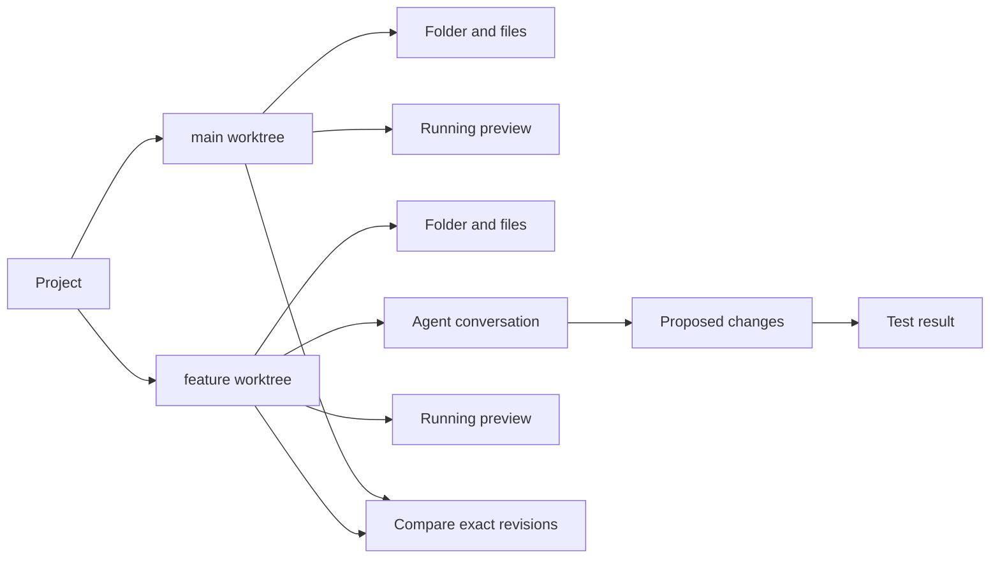

# Spatial development in Viewer

Research and product proposal, October 24, 2026. This is a design document, not a
claim that these features ship today and not an accepted architecture decision.
It records the owner's branch/worktree, agent-conversation and spatial-review
ideas before implementation expands. The current reliability work retains priority.

## Product direction

Viewer should make related work visible, inspectable and easy to return to. A
folder, a branch, a question, a proposed change, a test result and a running
preview should be connected objects in one workspace. The useful result is less
context switching and clearer decisions. Putting existing tabs into 3D is not
enough.

Viewer remains a capable file manager. Someone opening Downloads should get a
normal folder with predictable selection, paths, previews and file operations.
Development tools appear when relevant or explicitly invoked. A non-Git folder
must not become a second-class location. A user should never need to understand
agents, graphs or camera transforms to open a file.

For development, the compelling loop is:

1. Open the project and understand its current state.
2. Explore another branch beside it, without changing the first view's files.
3. Start a human-controlled task or agent session in an explicit worktree.
4. Follow a change to its source, diff, tests and rendered result.
5. Review what actually happened, then explicitly commit or integrate it.
6. Put the work down and return with the context intact.

The central product question is: **Can I see what changed, why, where it ran and
what proves it works, without reconstructing the story from several windows?**

## What exists and what is missing

The [capability map](capabilities.md) describes the implemented baseline. Source
already includes independent folder roots, linked previews, text/image diffs,
HEAD comparisons, Git status, terminals, Chat, workflows, evidence navigation,
saved arrangements, views, Tour and local-server planes. Native acceptance is
candidate-specific; the [qualification ledger](release-qualification.md) remains
authoritative for what has actually been tested.

The new human Git quick actions are under implementation. They are separate from
the background, opt-in, hardened Git reader. They do not yet imply worktree
management, branch snapshots or a structured coding-agent integration.

Still missing for the proposed experience:

| Capability                                     | Why it matters                                                                                      |
| ---------------------------------------------- | --------------------------------------------------------------------------------------------------- |
| Worktree inventory and explicit branch opening | Two editable branches must resolve to different checkout directories.                               |
| Read-only revision folders                     | Browsing a commit should not require a checkout, dependencies or a running process.                 |
| Repository-aware comparison                    | A diff needs exact left/right revisions, index/worktree state and freshness.                        |
| Structured agent-session adapter               | A terminal screen alone cannot reliably supply tool calls, conversation branches or approval state. |
| Task and evidence relationships                | A conversation, file change and passing test need a recorded basis for their connection.            |
| Shared activity and attention model            | Background work should report waiting, failed and completed states without stealing focus.          |
| Durable session recovery                       | Reopening a layout must not silently restart a server, agent, commit or push.                       |
| Linked work-area templates                     | Reuse an arrangement without copying live processes, paths, credentials or permissions.             |
| Isolated interactive browser                   | The current offline HTML preview and static local server are not a general agent browser.           |
| Evaluation and scale evidence                  | Demonstrate improved workflows and responsive large spaces, not just attractive screenshots.        |

## A plane is a view; a worktree supplies editable files

A Git repository can have multiple linked worktrees. They share repository data,
while each checkout has its own working files, HEAD and index. Git normally
refuses to check out the same branch into a second worktree. Viewer should retain
that protection. [Git worktree manual](https://git-scm.com/docs/git-worktree).

These distinctions should appear consistently in labels and saved records:

| Object                   | Meaning                                                          | Example                     |
| ------------------------ | ---------------------------------------------------------------- | --------------------------- |
| Repository               | Shared Git history and repository identity                       | `viewer`                    |
| Worktree                 | A concrete editable checkout and its Git administrative identity | `/code/viewer-auth`         |
| Revision snapshot        | Read-only tree pinned to a resolved commit object                | `main at 8ab12…`            |
| Folder plane             | A presentation of a folder in a worktree or revision snapshot    | `src/renderer`              |
| Work area, proposed term | A named grouping of related planes and task context              | `Authentication experiment` |
| Viewer workspace         | The existing saved spatial environment                           | `Engineering`               |

A work area is not automatically a Viewer workspace, and neither is necessarily
one worktree. A workspace can contain several projects and several worktrees of
one project. A worktree can appear in several folder, diff, terminal and preview
planes. This is what makes direct comparison possible.

### Three explicit branch operations

**Browse branch** opens a read-only revision folder. Resolve the branch name once,
record the commit ID and show both. Provide an explicit Refresh to branch tip.
Two pinned snapshots remain stable even if another process moves a branch.

**Open branch for editing** finds an existing worktree for that branch and opens
it. If none exists, offer to create one at a reviewed destination. If already
open, offer its existing plane or another view of the same checkout. A second
view shares files and the index; its navigation and selection remain independent.

**Switch branch in this checkout** is a separate, more consequential action.
It affects every plane, editor, terminal and process using that checkout. Show
those dependents, check unsaved buffers and Git state, and revalidate after review.
Never implement a per-plane branch selector by silently running checkout on a
shared folder.

Detached revisions, unborn branches, unavailable remotes and branches already
checked out elsewhere need honest states. No automatic force, stash, reset or
dependency install. A remote-tracking branch is not an editable local branch
until the user explicitly creates the local checkout.

### Worktree lifetime

Closing a plane closes its view. Closing a work area preserves its files. Neither
operation removes a worktree. Creating a worktree creates real files, can consume
substantial disk space and may encounter configured checkout behavior. Make the
destination, branch and process behavior reviewable before creation.

Removal is a separate, exact-path, native-reviewed Trash operation under the
owner's [removal policy](../AGENTS.md). Do not expose `git worktree remove` as a
cleanup shortcut: it removes files directly. Do not prune administrative records
automatically. A future Trash design must preserve the checkout and enough
registration information for recovery, handle linked administrative records and
refuse unsupported cases. Until that design is implemented, closing and revealing
worktree locations are sufficient; managed removal stays unavailable.

Worktrees do not isolate credentials, network, hooks, executable code or the rest
of the filesystem. Separate checkout directories reduce accidental file conflicts;
they are not a sandbox for agents. Shared refs and configuration also need
repository-level coordination.

## Give space a useful job

The layout should express relationships, preserve orientation and help users
compare alternatives. It should not require remembering coordinates.

### Branch work areas

An explicit Open branch beside this action creates a readable neighboring group:
folder, changes, terminal, conversation and optional running preview. Both branch
groups can remain visible. Show project, branch and checkout identity in the
group's heading; repeat enough identity in dependent planes to prevent mistakes
when they are isolated or moved.

The diagram is conceptual. Git topology, task relationships and Plurid's
parent/child layout are different structures. Do not force all three into one
tree or duplicate domain records to satisfy a layout.

### A review path through a change

Selecting a changed file opens its diff beside the originating changes plane.
Following a hunk opens the exact source location. Following a test result opens
the bounded output and the captured command/environment summary. A related
preview opens beside that evidence. Back returns to the caller's camera and
reading position.

A saved review path can guide a teammate through selected changes and evidence.
It should reuse views/Tour for navigation, while the review records have their
own status and source versions. Visiting a plane is not approval. Completing a
Tour is not proof that tests passed.

### Semantic zoom and focus

At overview scale, show a work area's name, branch, change count and attention
state. At reading scale, show the real folder, diff or conversation. At editing
scale, isolate or dock the plane. Keep the details in accessible DOM content and
provide a list/keyboard route to every object.

Start with deterministic side-by-side layouts and saved views. Let users move
groups freely, but keep labels and Home/Back reliable. Do not assign mandatory
meaning to a third axis, force continuous camera animation or encode correctness
in color or depth alone. Reduced motion and a comfortable two-dimensional layout
must remain useful.

### Comparison rooms

Build a review arrangement from an explicit comparison: base revision, candidate
revision, changed files, focused diff and associated evidence. Name all sides.
Useful comparisons include HEAD versus working files, index versus working files,
HEAD versus index, two commits, two branch tips and merge-base versus a branch.
These answer different questions and must not share an ambiguous Diff label.

Later, a three-way merge can expose base/ours/theirs/result with conflict
navigation. Cross-branch copy or hunk application must become a reviewed,
version-checked operation. Never copy silently through synchronized scrolling or
shared selection. Binary files, submodules, renames, symlinks, large diffs and
untracked files need explicit handling and limits.

### Linked arrangements

Borrow the usefulness of TrenchBroom's linked groups: reuse a well-designed
structure. A Viewer template could instantiate a folder, changes, terminal and
preview layout for another worktree. Keep local placement and selected display
choices independent. Propagating later template updates must be explicit and
previewed. [TrenchBroom linked groups](https://trenchbroom.github.io/manual/latest/#linked-groups).

Copying an arrangement must never copy authorization, a running process, a live
provider connection or an automatic execution request. Link structure and
presentation are reusable; task state and authority belong to their owners.

## Codex and Claude: terminal first, structured sessions separately

Keep the familiar terminal path. A user should be able to open a terminal in an
explicit worktree and run their installed `codex` or `claude`, including tmux when
they choose. Preserve their configured shell and normal terminal behavior. Do
not require a second model account just to display a terminal.

Structured integration is a separate feature. It should show actual conversation
messages, tool activity, changed files, pending questions and approvals, with
links into Viewer. Parse supported events rather than scraping terminal text.
An existing unrelated iTerm/tmux process cannot be assumed attachable through an
SDK; attaching to or importing a session needs an explicit supported route and
user choice. Do not read all personal transcript stores automatically.

### Integration routes

| Route                           | Suitable role                                                | Practical constraint                                                                                     |
| ------------------------------- | ------------------------------------------------------------ | -------------------------------------------------------------------------------------------------------- |
| Ordinary PTY                    | Run the user's installed interactive CLI                     | Full-screen terminal output is not a trustworthy structured event stream.                                |
| Codex app-server adapter        | Explore a persistent conversation/event/approval UI          | Pin the protocol and CLI; the installed command identifies itself as experimental.                       |
| Codex SDK                       | Start/resume bounded programmatic tasks                      | Evaluate lifecycle and approval coverage against actual product needs.                                   |
| Claude Agent SDK adapter        | Structured messages, tools, sessions and permission handling | Use supported authentication; do not assume the user's consumer login is available to a third-party SDK. |
| Explicit session-history import | Explore past conversations without resuming execution        | Bounded, local, user-selected; preserve provider attribution and privacy.                                |
| Viewer's existing agent tools   | Let a client inspect and navigate granted Viewer content     | Viewer desktop authority and review remain the enforcement point.                                        |

OpenAI documents app-server thread/turn/item events, interruption and approval
requests; its SDK provides a narrower programmatic route. Prefer a local,
version-pinned transport for the first prototype and qualify it before release.
[Codex app-server](https://learn.chatgpt.com/docs/app-server),
[Codex SDK](https://learn.chatgpt.com/docs/codex-sdk).

Anthropic documents an Agent SDK and session-history helpers. Test capabilities
against the chosen version rather than inventing a parser for private transcript
formats. Its SDK documentation also distinguishes supported API authentication
from consumer account integration.
[Agent SDK](https://code.claude.com/docs/en/agent-sdk/overview),
[session browser](https://platform.claude.com/cookbook/claude-agent-sdk-05-building-a-session-browser).

Local read-only checks on October 24 found Codex CLI `0.164.0`, Claude Code
`2.1.310` and tmux on this Mac. `codex app-server --help` labels the interface
experimental. These checks did not launch an agent, read credentials, attach to a
session or establish end-to-end integration compatibility.

### Conversation forks need code context

A conversation fork and a Git branch are independent actions. Offer clear choices:
continue a question over the same pinned revision, fork discussion with the same
worktree, or create a new worktree for an experiment. Display which occurred.
Never imply that branching chat duplicated code, files or execution authority.

A conversation plane can spawn linked tool-result or artifact planes on demand.
Do not create a permanent plane for every token or every read call. Group routine
events into a bounded activity list; promote relevant files, proposals and
evidence when the user follows them. Several views of a conversation reference
one durable conversation rather than racing independent transcript copies.

### Attention without interruption

Use a shared observed activity model: preparing, running, waiting for the person,
succeeded, failed, cancelled, disconnected and outcome unknown. Keep an agent's
reported completion separate from process exit and verification outcome. Expose
the source of a state: adapter event, process exit, explicit user action or an
unverified terminal status report.

Show a quiet badge on the relevant work area, plus a searchable attention list
across workspaces. Clicking an entry returns to the exact waiting question,
approval, failed test or completed artifact. Background work must not steal the
camera or keyboard focus. A disconnected session must not appear complete.

Terminal status protocols could improve this later, but terminal escape sequences
are untrusted display hints. They cannot approve tools, create grants, claim a
verified test pass or impersonate another session.

## Evidence, context and intent

The proposed [Viewer Journal plane](journal-plane.md) supplies searchable event
history scoped by workspace, plane and task. It complements attention badges and
evidence navigation while existing operation receipts and native consent retain
authority. The linked proposal defines queries, correlation, privacy, bounds and
retention constraints.

The strongest agent feature is a reliable connection between a request and
inspectable results. Record the user request, explicitly acknowledged assumptions,
source versions, proposed or observed changes, commands/results and review outcome.
Keep reported reasoning summaries distinct from execution evidence.

An evidence record should identify the adapter/session/turn, worktree or revision,
relevant paths and versions, timestamp, bounded result reference and freshness.
A test result applies to a captured source state. Editing those files afterwards
marks the result stale; it does not keep a green Verified badge. A historical
passing build remains available as history.

### Context receipts

Let users explicitly send a selection, folder, file excerpt, diff or rendered
result into a conversation. Show what was selected, what the client actually
delivered, its version, truncation and recipient. Allow revocation for future
reads. Previously delivered information cannot be recalled from the provider.

A receipt can establish that a tool supplied content. It cannot establish that a
model understood it or still retains it after compaction. Labels such as Sent,
Read tool returned and Pinned for this request are more honest than Agent knows.
Reopen source links after compaction rather than injecting an entire old workspace
into every prompt.

### Small, living project intent

Keep goals, constraints and enduring decisions in concise, ordinary project files
that remain usable outside Viewer. Connect relevant passages to tasks and code;
show when their source versions changed. Detect a stale reference instead of
presenting every spec as permanent truth.

An assumptions review is useful before an expensive action: the agent records
uncertainties, the person corrects the consequential ones, and the accepted
assumptions stay attached to that task. This is lighter than requiring a
`SPEC.md` for every module. Code, tests, observed behavior and human decisions can
disagree; display the disagreement rather than declaring one infallible.

Do not promise that a spec graph guarantees agents read or obey anything. What
Viewer can enforce is tool authority, delivery records, version checks and review.

## Architecture: extend existing owners

Use the current domain/desktop/renderer split and established command registry.
Do not introduce a second filesystem, job system, permission store or spatial
engine. The first implementation should be small enough to reject or replace.

| Responsibility                        | Proposed owner and seam                                                                               |
| ------------------------------------- | ----------------------------------------------------------------------------------------------------- |
| Repository and worktree discovery     | Desktop Git module; canonical paths, administrative identities, bounded Git calls and invalidation    |
| Worktree creation                     | Explicit reviewed desktop operation with durable receipt; no implicit startup or removal              |
| Read-only tree listing and file bytes | Versioned source-reference adapter; reuse preview/inspection budgets and capabilities                 |
| Comparison                            | Existing comparison module extended with exact revision/index/worktree sources and freshness          |
| Agent transport                       | Desktop adapter owns one process/connection, protocol negotiation, cancellation and approval requests |
| Agent transcript/activity             | Durable local records; provider events retained with attribution and bounded payloads                 |
| Tasks and evidence relationships      | Domain records independent of camera geometry; revisions and observable outcomes, not inferred truth  |
| Spatial presentation                  | Existing workspace controller projects records into Plurid planes/links/views                         |
| Authority                             | Existing private desktop consent and operation services; adapters cannot grant themselves access      |

Start with a discriminated source reference: live worktree path or repository
tree at a full commit ID plus relative path. Do not disguise `branch:path` as a
local filesystem path or pass it into file mutation APIs. Branch names need not
be valid filenames. A revision folder is read-only even if its preview renderer
also supports editing local files.

Keep domain identities separate from runtime plane IDs. The same source can have
several views, each with its own reading/selection state. A graph relationship
may cross roots or appear in several layouts; it must not transfer lifecycle
ownership or authorization. Keep high-volume event storage separate from the
small saved arrangement.

Serialize mutations of one worktree's index. Coordinate operations that affect
shared refs/configuration at the repository level. Recheck captured source and
repository identity after any human review. External Git processes can still
change state; locking internal jobs alone does not establish freshness.

### Plurid and the wider ecosystem

The local [engine architecture](../../plurid/docs/ARCHITECTURE.md) describes real
DOM planes with engine-owned camera, layout, selection and persistence hooks.
The [control surface](../../plurid/docs/CONTROL_SURFACE.md) already exposes linking,
framing, selection, arrangements and named viewpoints. Viewer should consume and
measure those capabilities, not implement its own camera or infer native file
identity from an engine route.

The ecosystem [strategy](../../../../docs/00-strategy.md) assigns general spatial
mechanics to the engine and domain behavior to products.
[Dechat's direction](../../../../docs/08-product-dechat.md) already includes
conversation branching, inherited ancestry, artifact planes and spatial reading.
Reuse proven interaction vocabulary and test cases. A small shared presentation
module may become justified after two real consumers; do not import Dechat's
browser credential/storage policy into this native file manager or create a
large speculative common framework.

### Authority is not inherited from proximity

Dragging a folder next to a conversation, duplicating a work area or linking a
tool result grants no file access. Viewer Chat remains proposal-only. Structured
external agents need their own explicit integration policy; a normal human-run
terminal is not evidence that Viewer can intercept every operation it performs.

For a managed agent that can write, the unresolved prerequisite is enforceable
execution isolation and removal control. Do not enable opaque shell tools merely
because they run in a worktree. Keep unmediated shell/executable/terminal-input
routes unavailable to Viewer agents under the existing policy. If a harness
cannot satisfy that policy, support observation and scoped Viewer tools first.
Approval UI must present the real request, owner and target and wait for the
person; no renderer, imported layout or agent event can manufacture consent.

## Persistence, lifecycle and scale

Restore layout and transcript references, not execution. Servers and agents reopen
stopped or disconnected unless an explicitly designed session manager proves the
original process is still owned and alive. Never replay commit, push, install,
worktree creation or a prior approval during restoration or arrangement Undo.

Do not promise tmux-style survival across an app exit until process ownership,
reconnection, authentication, crash recovery and orphan handling are implemented.
Begin with accurate stopped state and retained bounded output. A later daemon or
explicit tmux adapter is a product decision, not a side effect of restoring planes.

Culling a plane should suspend rendering and polling, not silently stop a task.
Closing a task view should offer clear keep-running versus stop behavior where
supported. Cancellation requests and confirmed termination are different states.
Revocation, eject and app shutdown must drain or stop dependent resources through
the existing services.

Measure representative spaces before promising scale: two active branch work
areas, many dormant work areas, large text/binary diffs, long transcripts, busy
terminals and previews. Keep bounded event queues, resumable cursors, virtualized
lists, lazy detail loading and subscriptions scoped to visible content. A log
flood must not stall camera input or fill disk indefinitely. Establish budgets
from measured baseline hardware and keep the result artifacts.

## Delivery sequence

Stage 1 is implemented: [existing worktree discovery and views](git-worktrees.md).
It includes explicit status inspection, reuse/another-view actions, branch/change
headers, linked Git comparisons and restoration of ordinary folder views. New
checkout creation and read-only revision folders remain stage 2.

| Stage | Deliverable                                                               | Acceptance evidence                                                                                                 |
| ----- | ------------------------------------------------------------------------- | ------------------------------------------------------------------------------------------------------------------- |
| 0     | Finish current Chat, fullscreen, sidebar/list fixes and Git quick actions | Regressions, package checks and honest native/live-provider results                                                 |
| 1     | Discover existing worktrees; open them beside one another                 | Two branches visible/editable independently; several views of one checkout clearly share files; no branch switch    |
| 2     | Reviewed worktree creation and read-only branch/commit folders            | Exact destination/revision, no surprise install or execution, branch-already-checked-out handling, restart recovery |
| 3     | Revision-aware comparison room                                            | Exact sides, stale-result detection, text/image/binary cases and preserved source versions                          |
| 4     | Agent terminal workflow and common attention list                         | Normal shell/CLI works, captured worktree, accurate exit/disconnect state and no fake restoration                   |
| 5     | One structured adapter prototype, Codex first for evaluation              | Pinned protocol, transcript/events, interruption, human approval and no authority bypass                            |
| 6     | Task/evidence navigation and conversation forks                           | Follow a request through changes to evidence, distinguish chat fork from code fork, mark stale proofs               |
| 7     | Reusable work-area templates and deeper integrations                      | Two real workflows demonstrate reusable structure without copied jobs, secrets or grants                            |

Do not start all stages at once. Each stage should improve a complete workflow
without depending on the rest. The first striking demo should be small: open
`main` and `feature` beside each other, follow one changed file into a diff, inspect
a test result and compare running previews, then resume that exact context later.

## Further high-value ideas

- **Composable actions:** build typed, contextual actions and organize them in
  palette groups while reusing command/workflow execution and review. See the
  [composition proposal](composable-actions.md).

- **Viewer Journal:** inspect application events by time, severity, workspace,
  plane and task, then follow an event to its source. See the separate
  [Journal proposal](journal-plane.md) for a concrete first delivery.

- **Compare alternatives:** several agent experiments in separate worktrees,
  compared by diff, tests, rendered result and reported cost. No automatic winner
  or merge; show tradeoffs and missing evidence.
- **Change impact exploration:** follow declared imports, references or observed
  test associations from a hunk. Label the relation's basis and freshness instead
  of inventing a definitive dependency graph.
- **Failure investigation space:** a failing test opens its output, source and
  recent relevant diff; user-selected evidence can be sent to an agent.
- **Before/after browser views:** separate local sessions, console/network
  evidence, stable viewports and source-state labels. Requires a real isolated
  browser module; static preview is not enough.
- **Share a review bundle:** portable selected diffs, notes, source references and
  receipts, with explicit redaction and missing-resource states. No default upload
  of private code, transcripts or environment.
- **Remote work areas:** the same source/evidence model with an explicit remote
  adapter later. Remote paths are never interpreted as local ones. Authentication,
  process ownership and synchronization require their own design.
- **Beginner explanations:** actions can explain staged versus unstaged changes,
  branch ownership and failed pushes using the current state. Offer the same
  concrete action an expert would invoke, with preview and clear consequences.

Defer a full IDE/LSP/debugger, unrestricted agent swarm, compulsory spec hierarchy,
custom Git storage, automatic branch cleanup and decorative 3D effects. Existing
editors and harnesses remain useful. Viewer can be distinctive by connecting their
work to sources, outcomes and human review.

## Questions to resolve before each stage

1. Should a new worktree live next to the repository or under a user-chosen work
   area directory? Discover existing locations first; do not establish a hidden
   managed location without a product decision.
2. What exact process/isolation mechanism can satisfy the removal policy for a
   write-capable structured harness? Observation alone must not imply enforcement.
3. Which minimal transcript/events are safe and sufficient to persist, and what
   are retention/export controls? Do not crawl personal histories by default.
4. Which comparison source is the beginner default, and how are index/working
   files/commit sides shown without ambiguity?
5. What measured workload makes grouped spatial review meaningfully easier than
   two windows or tiles? Test task success and orientation with real users.
6. Which interaction can be shared with Dechat after actual implementation, while
   native file authority remains local to Viewer?

These are design questions for the relevant stage, not blockers for the current
bug fixes, Git commands or existing-worktree discovery.

## Research record and source limits

The owner supplied the full text of the following discussion/articles. Browser
retrieval of the first three URLs failed on October 24; their supplied text was
read directly. Treat them as inspiration and attributed product claims, not
independent verification of every technical or business assertion.

| Source                                                                                                        | Useful lesson                                                                                                                     | What not to conclude                                                                                                                                          |
| ------------------------------------------------------------------------------------------------------------- | --------------------------------------------------------------------------------------------------------------------------------- | ------------------------------------------------------------------------------------------------------------------------------------------------------------- |
| [HN ThinkRail discussion](https://news.ycombinator.com/item?id=50219186)                                      | Users value integration, review tools and reduced context switching; assumptions deserve explicit review.                         | A comment thread does not establish the future of IDEs, a company's health or universal developer behavior.                                                   |
| [TrenchBroom interview](https://funcarena.com/articles/the-quake-fan-who-built-the-map-editor-everybody-uses) | Direct manipulation, linked structures, open formats, simple UX and maintainable code can sustain flow.                           | Do not reproduce incidental technical claims; the supplied statement equating NP-completeness with proven practical intractability is not a sound foundation. |
| [Rune 1.3 release](https://rune.build/blog/rune-1-3-release)                                                  | Activity/attention across sessions, workspace restoration, structured agent state, previews and careful modifier handling matter. | The pasted release is not proof Viewer already has those integrations or should copy its entire editor/platform scope.                                        |
| [ThinkRail product page](https://thinkrail.ai/)                                                               | Worktree-scoped files/terminals/chats and connected project intent are coherent product choices.                                  | Worktrees do not make execution safe, and specs do not guarantee model comprehension.                                                                         |

The ThinkRail page was retrieved and describes worktree-based workspaces, a
`pi`-backed agent and spec navigation. These are the vendor's current descriptions.
The implementation recommendations in this document are Viewer's own proposal.

Primary technical references were retrieved: Git worktree documentation, OpenAI
app-server/SDK documentation, Anthropic Agent SDK/session-browser documentation
and the TrenchBroom manual. Local Viewer and Plurid domain/architecture documents
were also read. Versions, experimental interfaces and product plans can change;
recheck these sources when an implementation stage begins.
